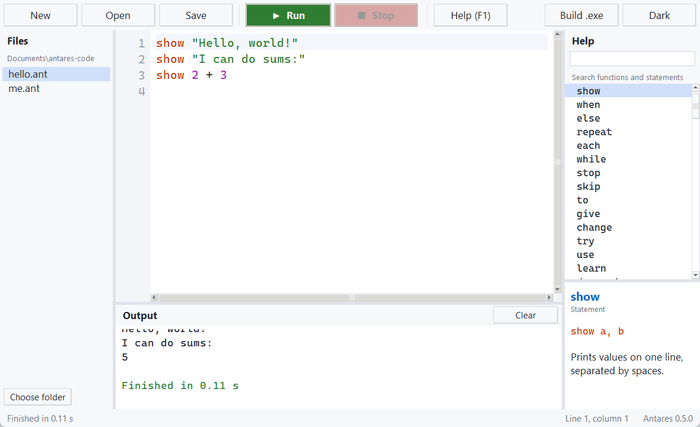
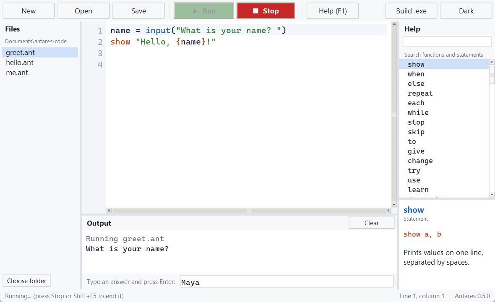
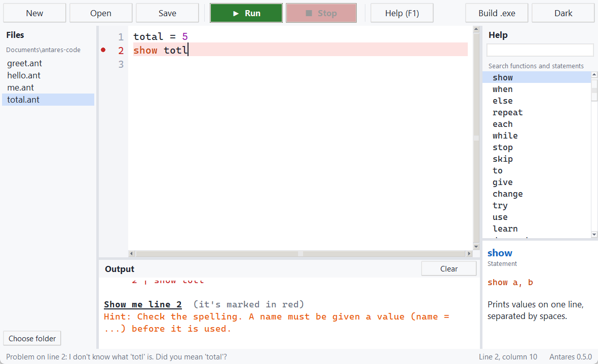

# Welcome {#welcome}

Welcome to Antares! This book teaches you to program from the very beginning. You don't need to know anything about programming to start: if you can use a computer and type, you can follow along.

## What is programming?

A computer is very fast, very obedient, and has no common sense at all. It does exactly what it is told, one step at a time. A **program** is a list of those steps, written down in a way the computer can follow. **Programming** is writing that list.

The steps are written in a **programming language**: a small, strict language with exact rules, so there is never any doubt about what a step means. Antares is one of these languages.

Here is a complete Antares program:

```antares
show "Hello! I am a computer program."
```

```output
Hello! I am a computer program.
```

The first box is the program. The second box is what the computer printed when it ran it. You'll see these pairs of boxes all through the book.

## What is Antares?

Antares is a small programming language made to be easy to read. Its main words are ordinary English verbs: `show`, `repeat`, `when`, `each`, `give`, `learn`. You can often guess what a program does before you know the rules.

It is also made for artificial intelligence. Most languages need extra libraries before a program can learn from data or talk to an AI model like Claude. In Antares those are built into the language itself, and later chapters show you how to use them.

Some things that make Antares friendly for beginners:

- **One small program to install.** Antares is a single file, with nothing else to set up.
- **Clear problem messages.** When something is wrong, Antares tells you the line, shows it, and explains the problem in plain words. If you misspell a name, it suggests the right one.
- **A friendly editor.** The Antares IDE is a free program for writing and running Antares code: press one button to run, and problems are marked on the line where they happen.
- **Try things instantly.** An interactive mode lets you type a line and see the answer straight away.
- **Fast when you need it.** When a program is finished, `antares build` can turn it into a fast stand-alone program you can share.

## How to read this book

The book is in four parts:

1. **Chapters 2 to 6:** the first steps. Showing things, remembering things in variables, making decisions and repeating actions.
2. **Chapters 7 to 13:** the building blocks. Lists, maps, functions, handling problems, text and files.
3. **Chapters 14 to 18:** what makes Antares special. Calculating with whole tables of numbers, programs that learn, asking AI models, working with bits, and live programs in the terminal.
4. **Chapters 19 and 20:** going further. Making programs fast, and three complete projects.

At the end, the appendices give what changed in each version of Antares, the answers to the exercises, a quick reference, a list of common problem messages and a glossary of words.

Read the chapters in order the first time; each one builds on the ones before. Type the examples in yourself rather than copying them. Typing teaches your fingers and your brain at the same time, and the small mistakes you make along the way are part of learning.

Throughout the book you'll find boxes like these:

> **Try it.** A small experiment to do right now.

<!-- -->

> **Remember.** Something important worth keeping in mind.

<!-- -->

> **Watch out.** A common mistake, and how to avoid it.

Each chapter ends with **Try it yourself** exercises. Do them! The answers are in Appendix B, but try each one properly before looking.

## Which version this book covers

This book covers **Antares 0.7.0**, released in November 2026. Everything in it also works in later versions. Appendix A describes what changed in each version, from 0.1.0 to 0.7.0.

## Summary

- A program is a list of exact steps for a computer.
- Antares is a small, readable language with AI tools built in.
- Code boxes show programs; the lighter boxes below them show what they print.
- Type the examples yourself, and do the exercises.

# Getting Set Up {#setup}

In this chapter you install Antares and the Antares IDE, write your first program, and meet the interactive mode.

## Installing Antares

Antares runs on Windows, macOS and Linux. The easiest way to install it is a one-line installer.

On **Windows**, open **PowerShell** (search for "PowerShell" in the Start menu) and type:

```shell
irm https://raw.githubusercontent.com/Madushan996/Antares-Programming-Language/main/install.ps1 | iex
```

On **macOS** or **Linux**, open the **Terminal** and type:

```shell
curl -fsSL https://raw.githubusercontent.com/Madushan996/Antares-Programming-Language/main/install.sh | sh
```

The installer puts Antares in your user folder and tells your computer where to find it. When it's done, **close the window and open a new one**, so it picks up the change. Then check that it worked:

```shell
antares version
```

```output
Antares 0.7.0
```

If you see a version number, Antares is installed. You can also download Antares by hand from the project's page on GitHub, github.com/Madushan996/Antares-Programming-Language, under **Releases**.

> **Remember.** The window where you type commands like `antares version` is called a **terminal** (on Windows, PowerShell is a terminal). You'll use it to run your programs.

## The Antares IDE

You write programs in an **editor**, a program for typing code. The easiest one to start with is the **Antares IDE**, made for beginners. IDE stands for *integrated development environment*: one window where you write a program, run it and see what it does.

To get it on Windows, go to **github.com/Madushan996/AntaresIDE**, open **Releases**, download **AntaresIDE.exe** and double-click it. It's one file, with nothing else to install. (On macOS and Linux, run it from its source with Python: the page explains how.)

The window has four parts:

- **In the middle, your code.** The words are coloured as you type, and every line is numbered.
- **Underneath, the output.** This is what your program shows when it runs.
- **On the left, your files.** The other programs in the same folder; double-click one to open it.
- **On the right, help.** Every word of the language, explained. Click on a word in your code and press **F1** to see its help.

Antares programs are saved with the ending **`.ant`**, for example `hello.ant`.

## Your first program

1. Start the Antares IDE and press **New** (or Ctrl+N).
2. Type this line in place of what's there:

```antares
show "Hello, world!"
```

3. Press **Save** (or Ctrl+S). Make a new folder for your programs, for example `antares-code` in your Documents folder, and save the program in it as `hello.ant`.
4. Press the green **Run** button (or **F5**). What the program shows appears in the output underneath:

```output
Hello, world!
```

Congratulations: you've written and run a program!

The program runs from the top line to the bottom line. There's nothing else to write: no setup code, no special first function. Let's make it longer:

```antares
show "Hello, world!"
show "I can do sums:"
show 2 + 3
```

```output
Hello, world!
I can do sums:
5
```

Each `show` prints one line, in order. Here is how it looks in the IDE:



> **Try it.** The **Examples** menu in the IDE has eleven programs to try, from a times table to a game of Snake. Open one and press Run.

## Running programs from the terminal

You don't have to use the IDE. A program is a plain text file, so you can write it in any text editor, such as Notepad on Windows, TextEdit on a Mac (in plain-text mode) or Visual Studio Code, and run it in the terminal. Go to the program's folder with the `cd` command ("change directory"), then run the program with `antares`:

```shell
cd Documents/antares-code
```

```shell
antares hello.ant
```

```output
Hello, world!
```

This book shows programs and what they print, so the examples work the same way whichever you use.

## The interactive mode

Sometimes you just want to try something quickly. Run `antares` on its own, with no file name, and you get the **interactive mode**: you type a line, press Enter, and Antares answers straight away.

```session
Antares 0.7.0 — type a line and press Enter. `exit` to leave.
> 2 + 3
5
> 10 * 7
70
> "Hello" + " there"
Hello there
> exit
```

In the interactive mode you don't even need `show`: the value of what you type is printed for you. If you start something that needs more than one line, like a block in braces `{ }`, the prompt changes from `>` to `.` until you finish it. Type `exit` or `quit` to leave.

> **Try it.** Start the interactive mode and use it as a calculator. What is `123 * 456`? What is `2 ^ 10`?

## When something goes wrong

Everyone makes mistakes when typing programs. Antares is good at explaining them. Suppose you forget the closing quote:

<!-- error -->
```antares
show "Hello, world!
```

```output
Problem on line 1: this text is missing its closing "
     1 | show "Hello, world!
```

The message says **which line** has the problem, shows you that line, and explains what's wrong. In the IDE, the line is also marked in red and the cursor jumps to it. Fix the line and run the program again. Chapter 11 is all about problems and how to handle them.

## Try it yourself

1. In the IDE, write a program `me.ant` that shows your name on one line and your favourite food on the next.
2. Write a program that shows the result of `7 * 6`.
3. In the interactive mode, find out what `100 / 8` is.

## Summary

- Install Antares with the one-line installer, then check it with `antares version`.
- The Antares IDE is the easiest place to write programs: press Run (F5) to run one.
- Programs are text files ending in `.ant`; in the terminal, run one with `antares name.ant`.
- Programs run from top to bottom.
- `antares` on its own starts the interactive mode, a quick calculator and testing ground.
- Problem messages name the line and explain what's wrong.

# Showing Things {#show}

The `show` statement is how your program talks to you. In this chapter you learn to show text and numbers, to build sentences with values inside them, and to write notes in your code.

## show

`show` prints whatever follows it, then moves to a new line:

```antares
show "Good morning"
show 42
show 3.5
```

```output
Good morning
42
3.5
```

You can show several things at once by separating them with commas. They are printed on one line with a space between them:

```antares
show "The answer is", 42
show 1, 2, 3
```

```output
The answer is 42
1 2 3
```

## Text

A piece of text is written between double quotes `"..."`. Programmers often call text a **string**, because it's a string of letters. The quotes tell Antares where the text starts and stops; they are not printed.

```antares
show "Antares is a star in the constellation Scorpius."
```

```output
Antares is a star in the constellation Scorpius.
```

Some characters can't be typed directly inside text, so they are written with a backslash `\` in front. These are called **escapes**:

| Write | To get |
|---|---|
| `\n` | A new line |
| `\t` | A tab (a wide space) |
| `\"` | A double quote |
| `\\` | A backslash |
| `\{` | An opening brace (see below) |

```antares
show "Line one\nLine two"
show "She said \"hi\""
```

```output
Line one
Line two
She said "hi"
```

## Putting values inside text

Text can contain values in braces `{ }`. Antares works out what's inside the braces and puts the result into the text:

```antares
show "Two plus two is {2 + 2}"
show "A week has {7 * 24} hours"
```

```output
Two plus two is 4
A week has 168 hours
```

This is called **interpolation**, and you'll use it all the time once you have variables in the next chapter. If you need an actual brace in your text, write `\{`.

## Joining text with +

You can also join pieces of text with `+`. If one side is text and the other is a number, the number is turned into text first:

```antares
show "Antares" + " " + "rocks"
show "Score: " + 10
```

```output
Antares rocks
Score: 10
```

## Comments

A **comment** is a note for people reading the program. It starts with `#` and runs to the end of the line. Antares ignores comments completely:

```antares
# This program greets the user.
show "Hello"     # this part is ignored too
```

```output
Hello
```

Use comments to explain *why* the code does something, especially when it's not obvious. Your future self will thank you.

> **Try it.** Put a `#` at the start of a `show` line. Run the program again: the line is now a comment, so it no longer prints. This is a handy way to switch a line off without deleting it.

## Try it yourself

1. Show this on two lines with a single `show`: `Roses are red` and `Violets are blue`.
2. Show the sentence `There are 60 seconds in a minute and 3600 in an hour`, working out `3600` as `{60 * 60}`.
3. Show the text `C:\Users` (with a real backslash).

## Summary

- `show a, b, c` prints values on one line, separated by spaces.
- Text goes in double quotes; escapes like `\n` and `\"` give special characters.
- `{ }` inside text puts a value into the text.
- `+` joins text; numbers are turned into text when joined.
- `#` starts a comment, which Antares ignores.

# Variables and Numbers {#variables}

Programs need to remember things: a score, a name, a total. They do this with **variables**. This chapter shows you how to make and change variables, and how to calculate with numbers.

## Making a variable

A variable is a name with a value. You make one with `=`:

```antares
age = 12
name = "Sam"
show name, "is", age
```

```output
Sam is 12
```

Read `age = 12` as "age is now 12". From then on, whenever the program uses `age`, it means 12.

Variables really shine inside text with braces:

```antares
name = "Sam"
age = 12
show "{name} will be {age + 1} next year."
```

```output
Sam will be 13 next year.
```

## Changing a variable

A variable can be given a new value at any time. The old value is forgotten:

```antares
score = 0
show score
score = 10
show score
score = score + 5
show score
```

```output
0
10
15
```

The last line, `score = score + 5`, looks odd at first. It is *not* an equation. It means: work out `score + 5` (which is 15) using the current score, then make that the new value of `score`. This "take the old value and change it" pattern is everywhere in programming.

Because it is so common, there is a shorter way to write it. `score += 5` means exactly `score = score + 5`, and `-=`, `*=` and `/=` work the same way:

```antares
lives = 3
lives -= 1
coins = 10
coins += 5
coins *= 2
show lives, coins
```

```output
2 30
```

`+=` also adds text onto the end of text: `name += "!"`.

## Naming rules

Variable names:

- start with a letter or an underscore `_`,
- continue with letters, digits or underscores, like `score2` or `high_score`,
- are **case-sensitive**: `Score` and `score` are two different names.

A few words are part of the language and can't be used as names, for example `show`, `when`, `repeat`, `each`, `and`, `or`, `yes` and `no`. The full list is in Appendix C.

Choose names that say what the value is: `total_price` is much clearer than `tp` or `x`.

## Arithmetic

Antares can do all the usual sums:

| Operator | Meaning | Example | Result |
|---|---|---|---|
| `+` | add | `7 + 2` | `9` |
| `-` | subtract | `7 - 2` | `5` |
| `*` | multiply | `7 * 2` | `14` |
| `/` | divide | `7 / 2` | `3.5` |
| `%` | remainder after dividing | `7 % 2` | `1` |
| `^` | power | `7 ^ 2` | `49` |

```antares
show 7 + 2, 7 - 2, 7 * 2, 7 / 2, 7 % 2, 7 ^ 2
```

```output
9 5 14 3.5 1 49
```

The remainder `%` is more useful than it looks. For example, a number is even when its remainder after dividing by 2 is 0.

## Order of operations

As in maths, `^` is worked out first, then `*`, `/` and `%`, then `+` and `-`. Use parentheses `( )` to change the order:

```antares
show 2 + 3 * 4
show (2 + 3) * 4
show 2 * 3 ^ 2
```

```output
14
20
18
```

When in doubt, add parentheses. They never hurt, and they make your meaning clear to the reader.

## How numbers are shown

Numbers in Antares can have fractions. When a result goes on forever, like 10 divided by 3, Antares shows six digits after the point:

```antares
show 10 / 3
show 0.1 + 0.2
show 1.5 * 4
```

```output
3.333333
0.3
6
```

Notice that `1.5 * 4` shows as `6`, not `6.0`: whole numbers are shown without a point.

## Numbers and text are different

`42` is a number; `"42"` is text that happens to contain digits. You can't do sums with text. To turn text into a number, use `number(...)`; to turn a number into text, use `text(...)`:

```antares
typed = "42"
show number(typed) + 1
show text(7) + text(7)
```

```output
43
77
```

The built-in function `kind(...)` tells you what kind of value something is:

```antares
show kind(42), kind("42"), kind(yes)
```

```output
number text yes/no
```

## Asking the user

`input("...")` shows a question and waits for the user to type an answer and press Enter. The answer is always text:

<!-- norun -->
```antares
name = input("What is your name? ")
born = number(input("What year were you born? "))
show "Hello {name}! In 2030 you will be {2030 - born}."
```

```output
What is your name? Maya
What year were you born? 2014
Hello Maya! In 2030 you will be 16.
```

Here the user typed `Maya` and `2014`. Because the year comes back as text, the program uses `number(...)` before doing a sum with it.

In the IDE, a box appears under the output while the program waits for an answer. Type the answer there and press Enter:



## Try it yourself

1. Make variables `width = 8` and `height = 5`, then show the area of the rectangle (`width * height`) in a sentence: `The area is 40`.
2. Start with `coins = 20`. Add 15 coins, then spend 7 (changing `coins` each time), and show how many are left.
3. A film lasts 135 minutes. Show it as hours and minutes: `2 hours and 15 minutes`. (Hint: use `%` for the minutes, and `(135 - 15) / 60` or similar for the hours.)
4. Ask the user for two numbers with `input` and show their sum.

## Summary

- `name = value` makes or changes a variable.
- `x = x + 1`, or `x += 1`, means "make x one bigger".
- Names are case-sensitive and should describe the value.
- `+ - * / % ^` do arithmetic; parentheses change the order.
- Text and numbers are different kinds of value: `number(...)` and `text(...)` convert between them.
- `input("question")` reads a line typed by the user, as text.

# Making Decisions {#decisions}

So far our programs do the same thing every time. Real programs make decisions: if the password is right, let them in; if the score is high, say well done. This chapter shows you how.

## yes and no

A decision is based on a question with the answer **yes** or **no**. In Antares, `yes` and `no` are values, just like numbers and text:

```antares
raining = yes
show raining
show kind(no)
```

```output
yes
yes/no
```

## Comparing values

Comparisons answer yes-or-no questions:

| Comparison | Means |
|---|---|
| `a == b` | a is equal to b |
| `a != b` | a is not equal to b |
| `a < b` | a is less than b |
| `a <= b` | a is less than or equal to b |
| `a > b` | a is greater than b |
| `a >= b` | a is greater than or equal to b |

```antares
show 5 > 3, 5 < 3, 5 == 5, 5 != 5
show "cat" == "cat", "apple" < "banana"
```

```output
yes no yes no
yes yes
```

Text is compared in dictionary order, so `"apple" < "banana"` is yes.

> **Watch out.** One `=` gives a variable a value. Two `==` compare two values. Writing `when x = 3` by mistake is very common, and Antares will point it out.

## when

`when` runs a block of code only if a condition is yes. The block goes between braces `{ }`:

```antares
temperature = 31
when temperature > 30 {
    show "It's hot today!"
}
show "Have a nice day."
```

```output
It's hot today!
Have a nice day.
```

Change `temperature` to 20 and run it again: the first message disappears, but the last line still runs.

The lines inside the braces are usually **indented** (pushed in with spaces) so you can see what belongs to the block. Antares doesn't require the indentation, but always use it: it makes programs much easier to read.

## else

`else` gives the block to run when the condition is no:

```antares
age = 15
when age >= 18 {
    show "You can vote."
} else {
    show "You can vote in {18 - age} years."
}
```

```output
You can vote in 3 years.
```

## Choosing between many options

`else when` adds more conditions. They are checked in order from the top, and only the first one that is yes runs:

```antares
score = 72
when score >= 90 {
    show "Excellent"
} else when score >= 70 {
    show "Good"
} else when score >= 50 {
    show "Pass"
} else {
    show "Try again"
}
```

```output
Good
```

The score 72 is not 90 or more, but it is 70 or more, so `Good` is shown and the rest are skipped.

## Combining conditions: and, or, not

- `a and b` is yes when **both** are yes.
- `a or b` is yes when **at least one** is yes.
- `not a` turns yes into no and no into yes.

```antares
age = 14
has_ticket = yes
when age >= 12 and has_ticket {
    show "Enjoy the film!"
}
day = "Sunday"
when day == "Saturday" or day == "Sunday" {
    show "It's the weekend."
}
show not has_ticket
```

```output
Enjoy the film!
It's the weekend.
no
```

> **Watch out.** You can't write `0 < x < 10` as in maths. Write it as two comparisons: `0 < x and x < 10`.

## A complete example: even or odd

```antares
number_to_check = 17
when number_to_check % 2 == 0 {
    show "{number_to_check} is even"
} else {
    show "{number_to_check} is odd"
}
```

```output
17 is odd
```

## Try it yourself

1. Make a variable `password = "star123"`. Show `Welcome!` if it equals `"star123"`, and `Wrong password` otherwise.
2. Given `hour = 15`, show `Good morning` before 12, `Good afternoon` from 12 to before 18, and `Good evening` from 18 on.
3. A year is a leap year if it can be divided by 4, except that years divisible by 100 are not, unless they are also divisible by 400. Check `year = 2024` and show whether it is a leap year.

## Summary

- `yes` and `no` are values; comparisons like `==`, `!=`, `<` and `>=` produce them.
- `when condition { ... }` runs the block only when the condition is yes.
- `else when` and `else` handle the other cases; the first match wins.
- `and`, `or` and `not` combine conditions.
- Use `==` to compare and `=` to assign.

# Repeating Things {#loops}

Computers never get bored. They can repeat an action thousands of times without a mistake. This chapter shows the three ways to repeat in Antares: `repeat`, `each` and `while`.

## repeat

`repeat` runs a block a set number of times:

```antares
repeat 3 {
    show "Hip hip hooray!"
}
```

```output
Hip hip hooray!
Hip hip hooray!
Hip hip hooray!
```

Add `as name` to get a counter that goes 1, 2, 3, and so on:

```antares
repeat 5 as n {
    show "{n} squared is {n * n}"
}
```

```output
1 squared is 1
2 squared is 4
3 squared is 9
4 squared is 16
5 squared is 25
```

Each time through a loop is called a **round** (or an *iteration*).

## Counting up a total

A very common pattern is to start a variable at zero and add to it in each round:

```antares
total = 0
repeat 100 as n {
    total = total + n
}
show "1 + 2 + ... + 100 =", total
```

```output
1 + 2 + ... + 100 = 5050
```

## each

`each` goes through a collection of things one at a time. The variable after `each` holds the current item:

```antares
each fruit in ["apple", "banana", "cherry"] {
    show "I like {fruit}"
}
```

```output
I like apple
I like banana
I like cherry
```

The square brackets `[ ]` make a **list**, which Chapter 7 covers in detail. `each` also goes through the letters of a text:

```antares
each letter in "star" {
    show letter
}
```

```output
s
t
a
r
```

## range

`range` makes a list of counting numbers, and is very useful with `each`:

| Expression | Gives |
|---|---|
| `range(5)` | `[0, 1, 2, 3, 4]` |
| `range(2, 6)` | `[2, 3, 4, 5]` |
| `range(0, 10, 3)` | `[0, 3, 6, 9]` (counting in steps of 3) |

The end number is **not** included, and `range(5)` starts at 0. This is common in programming.

```antares
each i in range(1, 4) {
    show "Round {i}"
}
each i in range(10, 0, -5) {
    show i
}
```

```output
Round 1
Round 2
Round 3
10
5
```

## while

`while` repeats as long as a condition stays yes. Use it when you don't know in advance how many rounds you need:

```antares
money = 100
years = 0
while money < 200 {
    money = money * 1.1
    years = years + 1
}
show "Doubled after {years} years"
```

```output
Doubled after 8 years
```

The condition is checked before each round. When it becomes no, the loop ends and the program carries on below it.

> **Watch out.** If the condition never becomes no, the loop never ends. If your program seems stuck, press **Ctrl+C** in the terminal to stop it, then check that something inside the loop moves it towards the end.

## stop and skip

`stop` leaves a loop immediately. `skip` jumps straight to the next round:

```antares
each n in range(1, 20) {
    when n % 2 == 0 { skip }
    when n > 9 { stop }
    show n
}
```

```output
1
3
5
7
9
```

Even numbers are skipped, and the loop stops completely when it reaches a number over 9.

## Loops inside loops

A loop can contain another loop. Here is a small multiplication table:

```antares
repeat 3 as row {
    line = ""
    repeat 4 as column {
        line = line + "{row * column}\t"
    }
    show line
}
```

```output
1	2	3	4	
2	4	6	8	
3	6	9	12	
```

For each round of the outer loop, the inner loop runs all of its rounds. The `\t` puts a tab after each number so the columns line up.

## Try it yourself

1. Use `repeat` to show `Antares` 4 times.
2. Show the numbers 10, 9, 8, ..., 1 and then `Lift off!`.
3. Add up all the even numbers from 2 to 50.
4. Start at 1 and keep doubling. How many doublings does it take to go past one million? Use `while`.

## Summary

- `repeat n { ... }` runs a block n times; `repeat n as i` counts i from 1 to n.
- `each x in collection { ... }` goes through each item of a list, or each letter of a text.
- `range(start, end, step)` makes counting numbers, without the end.
- `while condition { ... }` repeats while the condition is yes.
- `stop` leaves a loop; `skip` goes on to the next round.
# Lists {#lists}

A variable holds one value. A **list** holds many values in order, like a shopping list. Lists are one of the most useful tools in programming, and this chapter shows you how to work with them.

## Making a list

A list is written in square brackets, with commas between the items:

```antares
planets = ["Mercury", "Venus", "Earth", "Mars"]
scores = [12, 7, 19]
empty = []
show planets
show scores
```

```output
["Mercury", "Venus", "Earth", "Mars"]
[12, 7, 19]
```

`len(...)` gives the number of items:

```antares
planets = ["Mercury", "Venus", "Earth", "Mars"]
show len(planets)
```

```output
4
```

## Getting one item

Each item has a position number called its **index**. Counting starts at **0**, not 1, so the first item is at index 0:

```antares
planets = ["Mercury", "Venus", "Earth", "Mars"]
show planets[0]
show planets[2]
show planets[-1]
```

```output
Mercury
Earth
Mars
```

A negative index counts from the end: `-1` is the last item, `-2` the one before it.

> **Remember.** The first item is `list[0]`, and the last is `list[len(list) - 1]`, or simply `list[-1]`.

Asking for an index that doesn't exist is a problem, and Antares tells you which indexes are valid:

<!-- error -->
```antares
planets = ["Mercury", "Venus", "Earth", "Mars"]
show planets[4]
```

```output
Problem on line 2: index 4 is out of range (valid: 0 to 3)
     2 | show planets[4]
```

## Changing an item

Give a new value to one position:

```antares
team = ["Ana", "Ben", "Cleo"]
team[1] = "Bilal"
show team
```

```output
["Ana", "Bilal", "Cleo"]
```

## Adding items

`push(list, item)` gives back a **new** list with the item added at the end. To keep it, store it back in the variable:

```antares
shopping = ["bread"]
shopping = push(shopping, "milk")
shopping = push(shopping, "eggs")
show shopping
```

```output
["bread", "milk", "eggs"]
```

> **Watch out.** `push(shopping, "milk")` on its own doesn't change `shopping`; it makes a new list and then throws it away. Write `shopping = push(shopping, "milk")`.

## Taking part of a list

A **slice** takes several items at once, written `list[start:end]`. As with `range`, the end is not included:

```antares
letters = ["a", "b", "c", "d", "e"]
show letters[1:3]
show letters[:2]
show letters[3:]
```

```output
["b", "c"]
["a", "b"]
["d", "e"]
```

Leaving out the start means "from the beginning"; leaving out the end means "to the end".

## Going through a list

`each` visits every item:

```antares
prices = [2.5, 4, 1.25]
total = 0
each price in prices {
    total = total + price
}
show "Total:", total
```

```output
Total: 7.75
```

When you also need the position, loop over `range(len(list))`:

```antares
podium = ["Zara", "Leo", "Kim"]
each i in range(len(podium)) {
    show "{i + 1}. {podium[i]}"
}
```

```output
1. Zara
2. Leo
3. Kim
```

## Useful list functions

| Function | Gives |
|---|---|
| `len(list)` | The number of items |
| `has(list, item)` | `yes` if the item is in the list |
| `sort(list)` | A sorted copy (numbers, or text in dictionary order) |
| `reverse(list)` | A reversed copy |
| `sum(list)`, `mean(list)` | The total and the average of a list of numbers |
| `max(list)`, `min(list)` | The largest and smallest number |
| `join(list, sep)` | All items joined into one text, with `sep` between them |
| `find(list, item)` | The position of the item, or -1 if it isn't there |
| `insert(list, position, item)` | A new list with the item put in at that position |
| `remove(list, position)` | A new list without the item at that position |
| `unique(list)` | The items without repeats |

```antares
marks = [62, 85, 71, 90]
show sort(marks), reverse(marks)
show sum(marks), mean(marks), max(marks), min(marks)
show has(marks, 71), has(marks, 100)
show join(["red", "green", "blue"], " and ")
```

```output
[62, 71, 85, 90] [90, 71, 85, 62]
308 77 90 62
yes no
red and green and blue
```

`insert` and `remove` change a list in the middle. Like `push`, they give back a new list, so store it back in the variable:

```antares
queue = ["Ana", "Ben", "Cleo"]
queue = insert(queue, 1, "Dev")
show queue
queue = remove(queue, 0)
show queue
show find(queue, "Cleo"), find(queue, "Zed")
show unique(["red", "blue", "red", "green", "blue"])
```

```output
["Ana", "Dev", "Ben", "Cleo"]
["Dev", "Ben", "Cleo"]
2 -1
["red", "blue", "green"]
```

## Lists of numbers are special

A list made only of numbers can be used in calculations as a whole. Arithmetic works on every number at once:

```antares
prices = [10, 20, 30]
show prices * 2
show prices + 1
show [1, 2, 3] + [10, 20, 30]
```

```output
[20, 40, 60]
[11, 21, 31]
[11, 22, 33]
```

This is a big feature of Antares, and Chapter 14 explores it. It has one surprise, though:

> **Watch out.** Because `+` adds lists of numbers item by item, `[1, 2] + [3]` does *not* make `[1, 2, 3]`. To add an item to a list of numbers, use `push`. Lists of text are joined by `+`: `["a"] + ["b"]` is `["a", "b"]`.

## Copies, not shared lists

When you give a list to another variable, it gets its own copy. Changing one doesn't change the other:

```antares
original = [1, 2, 3]
copy = original
copy[0] = 99
show original, copy
```

```output
[1, 2, 3] [99, 2, 3]
```

This protects you from a whole class of confusing bugs that other languages have.

## Try it yourself

1. Make a list of five friends' names. Show the first, the last, and how many there are.
2. Start with an empty list and use a `repeat` loop with `push` to fill it with the square numbers 1, 4, 9, 16, 25.
3. Given `temps = [18, 21, 25, 19, 23, 27, 22]`, show the hottest temperature and the average.
4. Go through `words = ["sun", "moon", "star", "comet"]` and show only the words with 4 letters (`len(word) == 4`).

## Summary

- `[a, b, c]` makes a list; `len` gives its size.
- `list[i]` gets an item; counting starts at 0; `-1` is the last item.
- `list[i] = v` changes an item; `list = push(list, v)` adds one.
- `list[start:end]` takes a slice, without the end.
- `each` goes through every item.
- Arithmetic on a list of numbers works on every number at once.

# Maps {#maps}

A list keeps things in order by number. A **map** keeps things by *name*. Think of a contact card: it has a name, a phone number and an email, each with a label. In Antares that's a map.

## Making a map

A map is written in braces, with `name: value` pairs:

```antares
pet = {name: "Biscuit", kind: "dog", age: 4}
show pet
```

```output
{name: "Biscuit", kind: "dog", age: 4}
```

Each name, like `age`, is called a **field** (or a key).

## Reading and changing fields

Use a dot to reach a field:

```antares
pet = {name: "Biscuit", kind: "dog", age: 4}
show pet.name, "is", pet.age
pet.age = 5
pet.colour = "brown"
show pet
```

```output
Biscuit is 4
{name: "Biscuit", kind: "dog", age: 5, colour: "brown"}
```

Giving a value to a field that doesn't exist yet adds it. Fields keep the order in which they were added.

Reading a field that isn't there is a problem:

<!-- error -->
```antares
pet = {name: "Biscuit"}
show pet.age
```

```output
Problem on line 2: this map has no 'age'
     2 | show pet.age
```

Use `has(map, "field")` to check first:

```antares
pet = {name: "Biscuit"}
when has(pet, "age") {
    show pet.age
} else {
    show "Age unknown"
}
```

```output
Age unknown
```

## Going through a map

`keys(map)` gives the field names and `values(map)` the values. `each` on a map goes through its field names:

```antares
stock = {apples: 12, pears: 0, plums: 7}
show keys(stock)
show values(stock)
each fruit in stock {
    show "{fruit}: {stock[fruit]}"
}
```

```output
["apples", "pears", "plums"]
[12, 0, 7]
apples: 12
pears: 0
plums: 7
```

`stock[fruit]` reads a field whose name is in a variable. `stock.fruit` would look for a field literally called "fruit".

## Lists of maps

Lists and maps combine naturally. A list of maps is like a small table, with one map for each row:

```antares
students = [
    {name: "Ana", mark: 82},
    {name: "Ben", mark: 67},
    {name: "Cleo", mark: 91}
]
best = students[0]
each s in students {
    when s.mark > best.mark { best = s }
}
show "Top of the class: {best.name} with {best.mark}"
```

```output
Top of the class: Cleo with 91
```

Inside square brackets a list can run over several lines, which keeps long lists readable.

Maps can also contain lists and other maps:

```antares
book = {title: "Learn Antares", tags: ["coding", "beginner"], author: {name: "Madushan"}}
show book.tags[1], book.author.name
book.tags[0] = "programming"
show book.tags
```

```output
beginner Madushan
["programming", "beginner"]
```

## Try it yourself

1. Make a map for a film with fields `title`, `year` and `rating`. Show a sentence like `Inception (2010) is rated 8.8`.
2. Add a field `seen: yes` to your film map, then show all its field names.
3. Make a list of three maps for books (each with `title` and `pages`) and show the total number of pages.

## Summary

- `{name: value, ...}` makes a map; `map.field` reads or changes a field.
- Giving a value to a new field adds it.
- `has(map, "field")` checks whether a field exists.
- `keys` and `values` give the names and values; `each` goes through the names.
- `map[name]` reads a field whose name is in a variable.
- Lists of maps make simple tables.

# Functions {#functions}

As programs grow, you find yourself writing the same steps again and again. A **function** gives a name to some steps, so you can use them whenever you like just by calling the name. You've already used built-in functions like `len`, `sort` and `upper`. Now you'll write your own.

## Writing a function

A function is made with `to`, then its name, then its **inputs** in parentheses. A short function can be written on one line with `=`:

```antares
to double(x) = x * 2
show double(4)
show double(21)
```

```output
8
42
```

Read `to double(x) = x * 2` as "to double x, work out x times 2". The value the function works out is called its **result** (or *return value*).

A function can have any number of inputs:

```antares
to area(width, height) = width * height
to greet(name) = "Hello, {name}!"
show area(3, 4)
show greet("Ravi")
```

```output
12
Hello, Ravi!
```

## Longer functions

A function with several steps uses a block in braces. Its result is the value of the **last line**:

```antares
to describe_temperature(t) {
    feeling = "mild"
    when t < 10 { feeling = "cold" }
    when t > 25 { feeling = "hot" }
    "{t} degrees is {feeling}"
}
show describe_temperature(5)
show describe_temperature(30)
```

```output
5 degrees is cold
30 degrees is hot
```

## give: returning early

`give` ends the function at once with a result. It is handy for dealing with special cases first:

```antares
to grade(mark) {
    when mark >= 90 { give "A" }
    when mark >= 75 { give "B" }
    when mark >= 50 { give "C" }
    "Not yet"
}
show grade(95), grade(80), grade(55), grade(20)
```

```output
A B C Not yet
```

A function that only *does* something, like showing text, doesn't need a result. Calling it is enough:

```antares
to banner(title) {
    show "*****"
    show title
    show "*****"
}
banner("Welcome")
```

```output
*****
Welcome
*****
```

Such a function gives back `nothing`, the value that means "no value".

## Why functions help

Functions let you:

- **avoid repeating yourself**: write the steps once, use them many times;
- **give steps a meaningful name**: `is_leap_year(2024)` explains itself;
- **break big problems into small ones**, each easy to understand and test.

You can define functions anywhere in the file, even below the code that uses them, so it's common to put the main part of a program first and the helper functions underneath.

## Variables inside functions

Variables made inside a function are **local**: they exist only while the function runs, and don't affect variables of the same name outside:

```antares
total = 100
to calculate() {
    total = 5       # a new, local total
    total * 2
}
show calculate()
show total
```

```output
10
100
```

This keeps functions from changing your program's variables by accident. A function can still *read* a variable from outside. When it really should *change* one, say so with `change`:

```antares
visits = 0
to visit() {
    change visits = visits + 1
}
visit()
visit()
visit()
show visits
```

```output
3
```

## Functions that call themselves

A function may call itself. This is called **recursion**, and it suits problems that contain smaller copies of themselves. The factorial of n (written n!) is n × (n-1) × ... × 1:

```antares
to factorial(n) {
    when n <= 1 { give 1 }
    n * factorial(n - 1)
}
show factorial(5)
```

```output
120
```

`factorial(5)` is `5 * factorial(4)`, which is `5 * 4 * factorial(3)`, and so on down to `factorial(1)`, which is simply 1.

## Try it yourself

1. Write `to square(n)` and use it to show the squares of 3 and 12.
2. Write `to is_even(n)` that gives `yes` or `no`. Test it on 10 and 7.
3. Write `to biggest(a, b, c)` that gives the largest of three numbers, using `when` (not `max`).
4. Write `to count_vowels(word)` that counts the letters a, e, i, o and u in a word. (Hint: `has("aeiou", letter)`.)

## Summary

- `to name(inputs) = expression` makes a one-line function.
- A block function's result is its last line; `give` returns early.
- Functions without a result give `nothing`.
- Variables made in a function are local; use `change` to change an outside variable.
- A function can call itself (recursion).

# Functions as Values {#function-values}

In Antares a function is a value, just like a number or a list. You can store it in a variable, give it to another function, or make one on the spot. This chapter shows how that leads to short, clear code.

## Quick functions with =>

`input => result` makes a small function without a name:

```antares
triple = x => x * 3
add = (a, b) => a + b
show triple(5), add(2, 8)
```

```output
15 10
```

With one input the parentheses can be left out; with several, or none, they are needed: `() => 42`. The part after `=>` must be a single expression. For anything longer, use `to`.

## map, filter and reduce

Three built-in functions take a function as an input and use it on every item of a list:

- `map(list, f)` applies `f` to every item and gives the new list.
- `filter(list, f)` keeps the items for which `f` gives `yes`.
- `reduce(list, f, start)` combines all the items into one value.

```antares
numbers = [1, 2, 3, 4, 5, 6]
show map(numbers, n => n * n)
show filter(numbers, n => n % 2 == 0)
show reduce(numbers, (total, n) => total + n, 0)
```

```output
[1, 4, 9, 16, 25, 36]
[2, 4, 6]
21
```

They work on any list, not only numbers:

```antares
names = ["ana", "ben", "cleo", "dmitri"]
show map(names, upper)
show filter(names, name => len(name) > 3)
```

```output
["ANA", "BEN", "CLEO", "DMITRI"]
["cleo", "dmitri"]
```

Notice `map(names, upper)`: any function can be passed, including built-ins and functions you wrote with `to`.

`sort_by(list, f)` sorts a list by whatever `f` gives for each item. It's how you sort a list of maps by one of their fields:

```antares
players = [{name: "Ana", score: 12}, {name: "Ben", score: 30}, {name: "Cleo", score: 21}]
ranked = sort_by(players, p => p.score)
show map(ranked, p => p.name)
show sort_by(["kiwi", "fig", "banana"], len)
```

```output
["Ana", "Cleo", "Ben"]
["fig", "kiwi", "banana"]
```

## Pipelines with ->

When you apply several functions one after another, nested parentheses get hard to read: `sum(map(sort(x), f))`. The **pipeline** arrow `->` passes the value on its left into the function on its right, so the code reads in the order things happen:

```antares
show [5, 3, 8, 1] -> sort -> reverse
```

```output
[8, 5, 3, 1]
```

`a -> f` means `f(a)`, and `a -> f(b)` means `f(a, b)`: the value goes in as the first input. A long pipeline can continue on the next lines, each starting with `->`:

```antares
scores = [72, 95, 58, 88, 61]
best_three = scores
    -> sort
    -> reverse
    -> slice(0, 3)
show best_three
```

```output
[95, 88, 72]
```

## Functions that make functions

A function can give back a new function. The new function remembers the values around it when it was made:

```antares
to multiplier(factor) = x => x * factor
double = multiplier(2)
times_ten = multiplier(10)
show double(7), times_ten(7)
```

```output
14 70
```

`double` remembers `factor = 2`, and `times_ten` remembers `factor = 10`. A function that remembers its surroundings like this is called a **closure**.

## Try it yourself

1. Use `map` to turn `[1, 2, 3, 4]` into `[10, 20, 30, 40]`.
2. Use `filter` to keep the words longer than 4 letters from `["tree", "planet", "sky", "galaxy"]`.
3. Use `reduce` to find the product (multiply all together) of `[1, 2, 3, 4, 5]`.
4. Write a pipeline that takes `[4, 1, 3, 2]`, sorts it, squares every number with `map`, and adds them up with `sum`.

## Summary

- `x => expression` makes a function value on the spot.
- `map`, `filter` and `reduce` apply a function to every item of a list.
- `a -> f(b)` means `f(a, b)`; pipelines read in the order things happen.
- Functions can make and return other functions (closures).

# When Things Go Wrong {#problems}

Every programmer, from beginner to expert, writes code that doesn't work the first time. The skill isn't avoiding mistakes; it's finding and fixing them. This chapter shows you how to read problem messages, how to deal with problems inside your program, and how to catch bad values early.

## Reading problem messages

When Antares finds a problem, it stops and tells you three things: the line number, the line itself, and what's wrong:

<!-- error -->
```antares
total = 5
show totl
```

```output
Problem on line 2: I don't know what 'totl' is. Did you mean 'total'?
     2 | show totl
```

Some messages appear before the program even starts, because the program isn't written correctly. These are **typing mistakes in the program's shape**, like a missing brace:

<!-- error -->
```antares
repeat 3 {
    show "hello"
```

```output
Problem on line 3: a block is missing its closing '}'
```

Antares only discovers the brace is missing when it reaches the end of the file, so it reports the line after the last one. When a message points past the end of your program, look for an opening brace `{` that was never closed.

Others happen while the program runs, when a step can't be done:

<!-- error -->
```antares
show "ten" - 1
```

```output
Problem on line 1: can't use - between a text and a number
     1 | show "ten" - 1
```

Appendix D lists the messages you'll meet most often and what they usually mean.

In the IDE, a problem is easy to find. The line is marked in red and the cursor jumps to it. Under the message, a **hint** in plain words explains what usually causes that kind of problem, and **Show me line 2** jumps back to the line if you've moved away:



> **Remember.** When you get a problem message, read it carefully, look at the line it names, and also at the line just before it. The cause is usually close by.

## Finding bugs

A **bug** is a mistake that makes a program do the wrong thing, even when no problem message appears. The best tool for finding bugs is `show`. Add `show` lines to see what your variables hold as the program runs, and you'll soon spot where things go differently from what you expected.

```antares
total = 0
each n in [3, 5, 7] {
    total = total + n
    show "after adding", n, "the total is", total
}
```

```output
after adding 3 the total is 3
after adding 5 the total is 8
after adding 7 the total is 15
```

Once the bug is fixed, remove the extra `show` lines (or turn them into comments with `#`).

## try and else

Sometimes a problem is expected: the user types a word where you wanted a number, or a file is missing. Instead of letting the program stop, you can handle the problem with `try`:

```antares
typed = "seven"
try {
    n = number(typed)
    show "Twice that is", n * 2
} else problem {
    show "That wasn't a number:", problem
}
show "The program carries on."
```

```output
That wasn't a number: "seven" isn't a number
The program carries on.
```

If anything inside `try` causes a problem, Antares jumps to the `else` block. The name after `else` (here `problem`) holds the message; you can leave it out if you don't need it. If nothing goes wrong, the `else` block is skipped.

A problem inside a function travels up to the nearest `try`, even through several function calls:

```antares
to safe_divide(a, b) {
    try {
        when b == 0 { fail("can't divide by zero") }
        a / b
    } else {
        0
    }
}
show safe_divide(10, 4), safe_divide(10, 0)
```

```output
2.5 0
```

## Raising your own problems

`fail("message")` raises a problem on purpose, and `check(condition, "message")` raises one only when the condition is `no`. Use them to stop as soon as something is wrong, with a clear explanation:

<!-- error -->
```antares
to make_account(age) {
    check(age >= 13, "you must be 13 or over, not {age}")
    "account created"
}
show make_account(16)
show make_account(9)
```

```output
account created

Problem on line 2: you must be 13 or over, not 9
     2 |     check(age >= 13, "you must be 13 or over, not {age}")
```

`check` is also how you test your own code: write `check(square(4) == 16, "square works")` and run the file. If nothing is shown, every check passed.

## Ranges: keeping numbers in bounds

New in version 0.4.0, you can tell Antares which numbers a variable is allowed to hold, by adding `within lowest to highest` where it first gets its value:

<!-- error -->
```antares
lives = 3 within 0 to 5
lives = lives + 1
show lives
lives = lives + 2
```

```output
4

Problem on line 4: lives only holds numbers from 0 to 5, not 6
     4 | lives = lives + 2
```

From then on, every value given to `lives`, anywhere in the program, is checked. The problem is reported at the exact moment the wrong number appears, instead of much later when something strange happens because of it.

For a list, every number in it is checked:

<!-- error -->
```antares
board = [0, 0, 0, 0] within 0 to 2
board[1] = 2
show board
board[3] = 7
```

```output
[0, 2, 0, 0]

Problem on line 4: board only holds numbers from 0 to 2, not 7
     4 | board[3] = 7
```

A function's inputs can have ranges too. They are checked each time the function is called:

<!-- error -->
```antares
to set_volume(level within 0 to 10) {
    show "Volume set to {level}"
}
set_volume(7)
set_volume(11)
```

```output
Volume set to 7

Problem on line 1: level only holds numbers from 0 to 10, not 11
     1 | to set_volume(level within 0 to 10) {
```

The message points at the function's first line, where the range is written, and names the input that was out of range.

Ranges can be used on top-level variables (not inside a function) and on function inputs. For a one-off check anywhere, there is also the function `within(x, lowest, highest)`, which gives back `x` if it is in range and raises a problem otherwise.

Ranges also make compiled programs faster, as Chapter 20 explains.

## Try it yourself

1. Write a program with a deliberate spelling mistake in a variable name, run it, and read the message.
2. Use `try` to turn the text `"12x"` into a number, showing `Not a number` if it fails.
3. Write `to percentage(part, whole)` that uses `check` to make sure `whole` isn't 0, then gives `part / whole * 100`.
4. Make a top-level variable `temperature = 20 within -50 to 60` and see what happens when you set it to 100.

## Summary

- Problem messages give the line, show it, and explain the problem.
- Use `show` to see what your program is doing when hunting bugs.
- `try { ... } else problem { ... }` handles problems instead of stopping.
- `fail` raises a problem; `check` raises one when a condition is `no`.
- `name = value within lo to hi` and `to f(x within lo to hi)` keep numbers in bounds (new in 0.4.0).

# Working with Text {#text}

Much of what programs handle is text: names, messages, files, web pages. This chapter collects the tools for working with it.

## Text is like a list of letters

Text has a length, and you can take letters and pieces of it with the same indexes and slices as lists:

```antares
word = "Antares"
show len(word)
show word[0], word[-1]
show word[0:3]
```

```output
7
A s
Ant
```

`each` goes through the letters one by one:

```antares
count = 0
each letter in "banana" {
    when letter == "a" { count = count + 1 }
}
show count
```

```output
3
```

## Changing text

| Function | Gives |
|---|---|
| `upper(t)`, `lower(t)` | The text in capitals or small letters |
| `trim(t)` | The text without spaces at either end |
| `replace(t, old, new)` | The text with every `old` replaced by `new` |
| `reverse(t)` | The text backwards |

```antares
show upper("loud"), lower("QUIET")
show "[" + trim("   tidy   ") + "]"
show replace("I like cats", "cats", "dogs")
show reverse("stressed")
```

```output
LOUD quiet
[tidy]
I like dogs
desserts
```

These functions never change the original text; they give back a new one.

## Splitting and joining

`split(t)` cuts text into a list of words. `split(t, sep)` cuts it wherever `sep` appears. `lines(t)` cuts it into lines. `join(list, sep)` does the opposite, gluing a list back together:

```antares
show split("the quick brown fox")
show split("2026-11-15", "-")
show lines("first\nsecond")
show join(["a", "b", "c"], "+")
```

```output
["the", "quick", "brown", "fox"]
["2026", "11", "15"]
["first", "second"]
a+b+c
```

## Searching

`has(t, part)` checks whether a text contains another text:

```antares
email = "sam@example.com"
when has(email, "@") {
    show "Looks like an email address"
}
```

```output
Looks like an email address
```

`find(t, part)` says *where* the part is: its position, or -1 if it isn't there:

```antares
email = "sam@example.com"
at = find(email, "@")
show at
show "The user name is " + email[:at]
```

```output
3
The user name is sam
```

## Lining up numbers

Two functions help when you print numbers. `fixed(x, places)` gives a number as text with exactly that many digits after the point. `pad(value, width)` adds spaces to make a value a set width, so columns line up. Numbers are lined up on the right and text on the left, as in a table:

```antares
show fixed(3.14159, 2), fixed(7, 2)
items = [["tea", 2.5], ["cake", 12], ["juice", 3.25]]
each item in items {
    show pad(item[0], 8) + pad(fixed(item[1], 2), 6, "right")
}
```

```output
3.14 7.00
tea       2.50
cake     12.00
juice     3.25
```

Because `fixed` gives text, `pad` would line it up on the left; the third input `"right"` lines it up on the right. A fourth input fills with another character instead of spaces, which is how you print times:

```antares
hour = 9
minute = 5
show "{hour}:{pad(minute, 2, "right", "0")}"
```

```output
9:05
```

## Text and numbers

To do arithmetic with digits that arrive as text, convert them with `number(...)`. To turn any value into text, use `text(...)`, or put it inside braces in a text:

```antares
parts = split("12,30,8", ",")
total = 0
each p in parts {
    total = total + number(p)
}
show "The total is {total}"
```

```output
The total is 50
```

## A small project: a word counter

Let's put it all together. This program counts how often each word appears in a sentence, using a map to keep the counts:

```antares
sentence = "the cat and the dog and the bird"
counts = {}
each word in split(sentence) {
    when has(counts, word) {
        counts[word] = counts[word] + 1
    } else {
        counts[word] = 1
    }
}
each word in counts {
    show word, counts[word]
}
```

```output
the 3
cat 1
and 2
dog 1
bird 1
```

## Try it yourself

1. Ask the user for their name with `input` and greet them in capital letters.
2. Write `to is_palindrome(word)` that gives `yes` when a word reads the same backwards, like `"level"`.
3. Given `csv = "Ana,82;Ben,67;Cleo,91"`, split it into records with `";"`, then each record into a name and a mark with `","`, and show each student's name and mark.

## Summary

- Text has a length, indexes and slices, like a list of letters.
- `upper`, `lower`, `trim`, `replace` and `reverse` give changed copies.
- `split`, `lines` and `join` cut text up and glue lists together.
- `has(t, part)` and `find(t, part)` search; `number` and `text` convert.
- `fixed(x, places)` and `pad(value, width)` line numbers up.

# Files and Bigger Programs {#files}

Variables disappear when a program ends. To keep information for next time, a program saves it in a **file**. This chapter shows how to read and write files, how to store whole values, and how to split a big program into several files.

## Writing and reading text files

`write(file, value)` writes text to a file, replacing whatever was there. `read(file)` gives back the whole file as text:

```antares
write("note.txt", "Remember to water the plants.")
show read("note.txt")
```

```output
Remember to water the plants.
```

The file is created in the folder where you ran the program. `exists(file)` tells you whether a file is there:

```antares
when exists("note.txt") {
    show "Found the note"
} else {
    show "No note yet"
}
```

```output
No note yet
```

(This example shows `No note yet` when run in a fresh folder; after the previous example has run, it would find the note.)

`append(file, text)` adds text to the end of a file instead of replacing it, which suits logs and diaries. `delete(file)` removes a file, and `files()` lists the files in the current folder (or `files("folder")` in another one):

```antares
append("diary.txt", "Monday: learned Antares\n")
append("diary.txt", "Tuesday: wrote a game\n")
show lines(trim(read("diary.txt")))
show has(files(), "diary.txt")
delete("diary.txt")
show exists("diary.txt")
```

```output
["Monday: learned Antares", "Tuesday: wrote a game"]
yes
no
```

## Saving whole values

Text files are fine for text, but often you want to keep a list or a map exactly as it is. `save(value, file)` stores any value, and `load(file)` brings it back:

```antares
game = {player: "Ana", level: 7, items: ["sword", "map"]}
save(game, "savegame.json")

loaded = load("savegame.json")
show loaded.player, "is on level", loaded.level
show loaded.items
```

```output
Ana is on level 7
["sword", "map"]
```

The file is stored in **JSON**, a common format that many other programs can read too. A program can use `exists` to load saved data when there is some, and start fresh otherwise:

```antares
when exists("highscore.json") {
    best = load("highscore.json")
} else {
    best = 0
}
score = 120
when score > best {
    show "New high score!"
    save(score, "highscore.json")
}
```

```output
New high score!
```

## JSON text

`json(t)` reads JSON text into Antares values, and `to_json(v)` turns a value into JSON text. This is useful when exchanging data with websites and other programs:

```antares
show to_json({name: "Ana", scores: [9, 7]})
data = json("[1, 2, 3]")
show sum(data)
```

```output
{"name":"Ana","scores":[9,7]}
6
```

## Information from outside

A program can find out what was typed after its name when it was started, with `args()`, and read the computer's settings with `env(name)`:

<!-- norun -->
```antares
# greet.ant
when len(args()) > 0 {
    show "Hello, {args()[0]}!"
} else {
    show "Hello, whoever you are!"
}
```

```shell
antares greet.ant Maya
```

```output
Hello, Maya!
```

`now()` gives the date and time, as a map:

```antares
show keys(now())
```

```output
["year", "month", "day", "hour", "minute", "second", "weekday"]
```

<!-- norun -->
```antares
t = now()
show "Today is {t.weekday} {t.day}/{t.month}/{t.year}"
```

## Splitting a program into files

When a program grows to hundreds of lines, it helps to split it into several files. `use "name"` runs the file `name.ant` from the same folder, and makes everything it defines available:

<!-- norun -->
```antares
# shapes.ant
to circle_area(r) = 3.14159 * r * r
to square_area(side) = side * side
```

<!-- norun -->
```antares
# main.ant
use "shapes"
show circle_area(2)
show square_area(5)
```

Running `antares main.ant` shows `12.56636` and `25`. Each file is only run once, however many times it is used, so files can safely `use` each other.

> **Remember.** All files share one set of top-level names. Give the functions and variables in a shared file names that won't clash with other files.

## Try it yourself

1. Write a program that saves a list of your three favourite songs to `songs.json`, then loads it and shows the second song.
2. Write a visit counter: load a number from `visits.json` if it exists (otherwise start at 0), add 1, show it, and save it back. Run it several times.
3. Move your `square`, `is_even` and `biggest` functions from Chapter 9 into `helpers.ant`, and use them from another file with `use "helpers"`.

## Summary

- `write` and `read` store and fetch text; `append` adds to a file; `exists`, `delete` and `files` manage files.
- `args()` gives the command line, `env(name)` a setting, and `now()` the date and time.
- `save` and `load` store any value as JSON, exactly.
- `json` and `to_json` convert between JSON text and values.
- `use "name"` brings in another file's functions and variables.
# Numbers in Bulk: Tensors {#tensors}

In Chapter 7 you saw that arithmetic works on a whole list of numbers at once. A list or grid of numbers is called a **tensor**. Tensors are the language of science, statistics and artificial intelligence, and in Antares they are built in. This chapter shows you how to make them and calculate with them.

## Vectors and matrices

A list of numbers is a **vector**. A list of equal-length lists of numbers is a **matrix**, a grid with rows and columns:

```antares
v = [1, 2, 3]
m = [[1, 2, 3], [4, 5, 6]]
show shape(v), shape(m)
show m
```

```output
[3] [2, 3]
[[1, 2, 3],
 [4, 5, 6]]
```

`shape(x)` gives the size of each direction: `m` has 2 rows and 3 columns. Matrices are shown row by row.

You reach a single number with `m[row, column]` (or `m[row][column]`), and whole rows or columns with slices:

```antares
m = [[1, 2, 3], [4, 5, 6]]
show m[1, 2]
show m[0]
show m[:, 1]
```

```output
6
[1, 2, 3]
[2, 5]
```

`m[:, 1]` means "every row, column 1".

## Making tensors

| Function | Gives |
|---|---|
| `zeros(3)`, `zeros(2, 3)` | A tensor filled with 0 |
| `ones(4)` | A tensor filled with 1 |
| `range(5)` | `[0, 1, 2, 3, 4]` |
| `rand(5)` | 5 random numbers between 0 and 1 |
| `randn(5)` | 5 random numbers from a bell curve around 0 |
| `reshape(x, 2, 3)` | The same numbers arranged in a new shape |
| `t(m)` | The matrix turned on its side (rows become columns) |

```antares
show zeros(2, 3)
show reshape(range(6), 2, 3)
show t([[1, 2], [3, 4]])
```

```output
[[0, 0, 0],
 [0, 0, 0]]
[[0, 1, 2],
 [3, 4, 5]]
[[1, 3],
 [2, 4]]
```

Random numbers are different every run. `seed(n)` makes them repeatable, which is useful when you want the same results each time:

```antares
seed(42)
a = rand(3)
seed(42)
b = rand(3)
show a == b
```

```output
yes
```

## Calculating with whole tensors

`+ - * / ^` work number by number. When the shapes differ, the smaller one is stretched to fit, which is called **broadcasting**: a single number combines with every number, and a row combines with every row:

```antares
m = [[1, 2], [3, 4]]
show m * 10
show m + [100, 200]
```

```output
[[10, 20],
 [30, 40]]
[[101, 202],
 [103, 204]]
```

Maths functions also work on every number at once: `sqrt`, `abs`, `exp`, `log`, `sin`, `cos`, `round`, `floor`, and others:

```antares
show sqrt([1, 4, 9, 16])
show round([1.2, 2.7, -0.4])
```

```output
[1, 2, 3, 4]
[1, 3, 0]
```

## Adding up

`sum` and `mean` add up or average all the numbers. Give a second input to work in one direction only: `0` goes down the rows (one answer per column), `1` goes across the columns (one answer per row):

```antares
m = [[1, 2, 3], [4, 5, 6]]
show sum(m), mean(m)
show sum(m, 0)
show sum(m, 1)
```

```output
21 3.5
[5, 7, 9]
[6, 15]
```

`max` and `min` find the largest and smallest numbers, and `argmax(v)` gives the *position* of the largest one:

```antares
votes = [12, 40, 25]
show max(votes), argmax(votes)
```

```output
40 1
```

## Matrix multiplication

`@` is matrix multiplication, the core operation of neural networks. Each row of the left matrix is combined with each column of the right one:

```antares
a = [[1, 2], [3, 4]]
b = [[5, 6], [7, 8]]
show a @ b
```

```output
[[19, 22],
 [43, 50]]
```

The top-left answer, 19, is 1×5 + 2×7: the first row of `a` times the first column of `b`.

## Why tensors matter

Tensor operations in Antares run as fast compiled code, even in a normal interpreted program. Multiplying two 300×300 matrices takes a few hundredths of a second. Writing the same thing with loops in most beginner languages takes many seconds. Whenever you can express a calculation on whole tensors instead of looping over numbers one by one, do it: it's shorter and much faster.

## Try it yourself

1. Make a 3×3 matrix with the numbers 1 to 9 using `range` and `reshape`, and show the sum of each row.
2. Prices `[4, 10, 2.5]` and quantities `[3, 1, 4]`: show the cost of each item and the total, without a loop.
3. Convert the Celsius temperatures `[0, 25, 100]` to Fahrenheit (`c * 9 / 5 + 32`) in one line.

## Summary

- Lists of numbers are tensors: vectors, matrices and beyond; `shape` gives their size.
- `zeros`, `ones`, `range`, `rand`, `reshape` and `t` make and rearrange them.
- Arithmetic and maths functions work on every number; shapes broadcast.
- `sum` and `mean` add up, optionally in one direction; `@` multiplies matrices.

# Teaching the Computer {#learning}

Usually *you* tell the computer exactly how to work something out. In **machine learning**, you give the computer examples and let it *learn* the rule itself. Antares has learning built into the language with just two words: `learn` and `descend`.

## The idea

Suppose you measure how far a toy car rolls for different pushes, and the points lie roughly on a straight line. A line is described by two numbers: its **slope** (how steep it is) and its **offset** (where it crosses zero). Machine learning finds the slope and offset that fit the data best.

It works like this:

1. Start with a guess, for example slope 0 and offset 0.
2. Measure how wrong the guess is with one number, the **loss**. A common choice is the average of the squared differences between the guesses and the real values.
3. Nudge the slope and offset a little in the direction that makes the loss smaller.
4. Repeat many times.

Step 3 needs to know, for each number, which direction reduces the loss. That direction is called the **gradient**. Working it out by hand is hard maths; Antares does it for you automatically.

## learn and descend

`learn` marks a value the program is allowed to adjust. `descend loss by rate` nudges every learnable value that the loss depends on, to make the loss smaller. The `rate` says how big each nudge is.

```antares
seed(1)
x = rand(50) * 4
y = 3 * x + 2 + randn(50) * 0.1

learn slope = 0
learn offset = 0

repeat 400 as step {
    guess = slope * x + offset
    loss = mean((guess - y) ^ 2)
    descend loss by 0.05
    when step % 100 == 0 { show "step {step}: loss {loss}" }
}

show "learned: y = {slope}x + {offset}"
```

```output
step 100: loss 0.011665
step 200: loss 0.010596
step 300: loss 0.010588
step 400: loss 0.010588
learned: y = 3.017847x + 1.961574
```

Let's read it:

- The first three lines make some pretend data: 50 points that follow `y = 3x + 2`, plus a little random noise.
- `learn slope = 0` and `learn offset = 0` are the starting guesses, marked as learnable.
- Each round makes guesses for every point at once (they're tensors!), measures the loss, and calls `descend`.
- After 400 rounds the program has found a slope of about 3 and an offset of about 2, the rule hidden in the data.

There is no separate framework, optimiser object or gradient code to write. That's the whole training interface.

## Seeing the gradient

`grad(loss, w)` shows the gradient without changing anything. For each number in `w`, it says how fast the loss grows when that number grows:

```antares
learn w = [1, 2, 3]
show grad(sum(w ^ 2), w)
```

```output
[2, 4, 6]
```

`descend` moves each number against its gradient: numbers with a big gradient move most.

## A tiny neural network

A **neural network** is a stack of simple calculations whose numbers are all learned. This one learns XOR, a classic puzzle: the answer is 1 when exactly one of two inputs is 1. A straight line can't separate those cases, but a small network can:

```antares
seed(7)
x = [[0, 0], [0, 1], [1, 0], [1, 1]]
y = [[0], [1], [1], [0]]

learn w1 = randn(2, 8) * 0.5
learn b1 = zeros(8)
learn w2 = randn(8, 1) * 0.5
learn b2 = zeros(1)

to net(input) = input @ w1 + b1 -> tanh -> (h => h @ w2 + b2) -> sigmoid

repeat 1000 {
    loss = mean((net(x) - y) ^ 2)
    descend loss by 0.05 using adam
}

show net(x) -> round
```

```output
[[0],
 [1],
 [1],
 [0]]
```

The network takes the inputs, multiplies by a matrix of learned weights (`@ w1`), adds learned numbers (`+ b1`), squashes the result with `tanh`, does it again, and finally squashes the answer between 0 and 1 with `sigmoid`. `using adam` picks the **Adam** method for nudging, which usually trains networks much faster than the plain method.

## Choosing between classes

Many problems are about choosing: is this email spam or not, which digit is in this picture, which word comes next? The answers are **classes**, numbered 0, 1, 2 and so on. A network for choosing gives a score for every class, and `cross_entropy` measures how wrong the scores are:

```antares
seed(3)
points = [[1, 2], [2, 3], [3, 5], [2, 1], [3, 1], [4, 2]]
classes = [1, 1, 1, 0, 0, 0]       # 1: above the diagonal, 0: below it

learn w = zeros(2, 2)
learn b = zeros(2)

repeat 300 {
    scores = points @ w + b        # two scores for each point
    loss = cross_entropy(scores, classes)
    descend loss by 0.1 using adam
}

show accuracy(points @ w + b, classes)
```

```output
1
```

`cross_entropy(scores, classes)` is small when the right class has the highest score, and large when it doesn't. `accuracy` says what fraction of the points get the right class: 1 means all of them.

## Better ways to learn

`descend` has four ways of nudging the learnable numbers:

| Way | When to use it |
|---|---|
| `descend loss by 0.1` | The plain way: always a step straight downhill |
| `using momentum` | Steps build up speed when they keep going the same way |
| `using adam` | Each number gets its own step size; usually much faster for networks |
| `using adamw` | Adam that also keeps the numbers small, for big networks |

Adding `clip 1` stops any single step from being too big, which keeps training steady: `descend loss by 0.01 using adamw clip 1`.

## A peek inside modern AI

The AI models that write text, such as Claude, are a kind of neural network called a **transformer**. A transformer reads text as a list of numbers, one per character or piece of a word. Its key idea is **attention**: every position in the text looks back at the positions before it and decides which ones matter for guessing what comes next.

Antares has all the parts a transformer needs: `take` turns character numbers into rows of learned numbers, `causal_mask` stops a position from peeking at later ones, `layer_norm` keeps the numbers in a steady range, and `gelu` is the squashing function transformers use. The `examples` folder has `tiny_gpt.ant`, a complete small transformer in about 100 lines. It learns a page of verse in a few seconds and then writes new lines of its own:

<!-- norun -->
```shell
antares examples/tiny_gpt.ant
```

Real models work the same way, but with billions of learned numbers instead of thousands, and trained on far more text.

## Keeping what was learned

Training can take a while, so save the learned numbers with `save` and load them next time:

<!-- norun -->
```antares
save({w1: w1, b1: b1, w2: w2, b2: b2}, "xor_model.json")

saved = load("xor_model.json")
learn w1 = saved.w1        # carry on training, or just use it
```

## Try it yourself

1. Change the learning rate in the straight-line example to `0.01` and then to `0.2`. What happens to the loss?
2. Make data that follows `y = -2x + 5` and check that the program learns a slope of about -2.
3. In the XOR example, change `repeat 1000` to `repeat 50`. Does the network still get all four answers right?
4. In the classes example, add the point `[1, 4]` with class 1 and the point `[5, 1]` with class 0. Does the accuracy stay at 1?

## Summary

- Machine learning adjusts numbers to make a loss smaller.
- `learn` marks adjustable values; `descend loss by rate` adjusts them.
- Antares works out gradients automatically; `grad` shows them.
- A neural network is learned matrices joined by squashing functions; `using adam` trains faster.
- For choosing between classes, use `cross_entropy` to learn and `accuracy` to check.
- Transformers, the networks behind AI chatbots, are built from attention; `examples/tiny_gpt.ant` is one.

# Talking to AI Models {#ai}

Antares can ask a large language model, such as Claude, a question and use the answer in your program, all in one line. It can also hold a conversation, let the model use your own functions, show it pictures, and find text by its meaning. This chapter shows how.

## Declaring a model

First, say which model to use, with `model`:

<!-- norun -->
```antares
model claude = "anthropic:claude-opus-5-5"
```

The text names the provider and the model. Optionally, `with` gives settings, such as a **system prompt** that guides every answer:

<!-- norun -->
```antares
model helper = "anthropic:claude-opus-5-5" with {system: "Answer in one short sentence."}
```

## Asking

`ask model "question"` sends the question and gives back the reply as text:

<!-- norun -->
```antares
model claude = "anthropic:claude-opus-5-5"
topic = "black holes"
answer = ask claude "Explain {topic} to a ten-year-old in two sentences."
show answer
```

## Answers you can calculate with

Add `as` to turn the reply into a value of the right kind:

| Form | Gives |
|---|---|
| `as text` | The reply as text (the same as leaving `as` out) |
| `as number` | The number in the reply |
| `as yes/no` | `yes` or `no` |
| `as list` | A list of text, one item for each line of the reply |

<!-- norun -->
```antares
moons = ask claude "How many moons does Mars have?" as number
show moons + 1
prime = ask claude "Is 91 a prime number?" as yes/no
names = ask claude "Give me five names for a cat, one per line." as list
each n in names { show "-", n }
```

## Answers with a shape

When you need several facts at once, describe the shape of the answer after `as`, and you get a map with exactly those fields:

<!-- norun -->
```antares
person = ask claude "Tell me about Ada Lovelace." as {name: text, born: number, known_for: list of text}
show person.name, "was born in", person.born
```

The field kinds are `text`, `number`, `yes/no`, `list of ...` (like `list of number`), and maps inside maps. The model is told the exact shape, so the answer always fits. The echo model makes up an answer of the right shape, which is handy for testing:

```antares
model bot = "echo"
show ask bot "Tell me about Ada" as {name: text, age: number}
```

```output
{name: "Tell me about Ada", age: 0}
```

## Conversations

Each `ask` normally starts fresh: the model doesn't remember the last question. A **conversation** remembers:

<!-- norun -->
```antares
chat = conversation(claude)
ask chat "My name is Ada and I like astronomy."
show ask chat "What should I read next?"     # it knows your name and interests
```

`history(chat)` gives everything said so far, as a list of maps with a `role` (`user` or `assistant`) and the `text`:

```antares
model bot = "echo"
chat = conversation(bot)
ask chat "Hello"
ask chat "How are you?"
show len(history(chat)), history(chat)[0].text
```

```output
4 Hello
```

## Tools: letting the model use your functions

A model can only guess at things it can't see, like today's prices or the notes on your computer. Give it **tools**, your own functions, and it can call them to find out. Programs that let a model use tools are often called **agents**:

<!-- norun -->
```antares
to percent(amount, rate) = amount * rate / 100

notes = {meeting: "Friday at 10:00", groceries: "eggs, rice, tea"}
to read_note(name) = notes[name]

model helper = "anthropic:claude-opus-5-5" with {tools: [percent, read_note]}
show ask helper "What is 17% of 2450, and when is my meeting?"
```

The model decides which functions to call and with what inputs. Antares runs them and hands back the results, and the model uses them to answer. To help the model, you can describe a tool with a map: `{run: read_note, about: "Reads one of my notes by name", inputs: {name: "text"}}`. The `examples` folder has `agent.ant`, a complete agent.

## Pictures

Models like Claude can look at pictures. Add them after `with`:

<!-- norun -->
```antares
show ask claude "What animal is in this photo?" with image("pet.jpg")
```

`image` reads .png, .jpg, .gif and .webp files.

## Replies as they arrive

Long replies can take a while. With `stream: yes`, the words appear on the screen as the model writes them, and `ask` still gives back the whole reply at the end. `examples/chat.ant` is a chatbot built this way:

<!-- norun -->
```antares
model storyteller = "anthropic:claude-opus-5-5" with {stream: yes}
ask storyteller "Tell me a short story about a brave turtle."
```

## Other models, and free ones on your own computer

Antares isn't tied to one company. Write a different provider before the colon:

| Write | Model |
|---|---|
| `"anthropic:claude-opus-5-5"` | Claude, from Anthropic |
| `"openai:gpt-5"` | GPT, from OpenAI |
| `"ollama:llama3.2"` | A free model that runs on your own computer |

**Ollama** runs AI models on your own computer: free, private, and working without the internet once a model is downloaded. Install it from ollama.com, download a model in the terminal with `ollama pull llama3.2`, and use it like any other:

<!-- norun -->
```antares
model local = "ollama:llama3.2"
show ask local "Give me a fun fact about octopuses."
```

## Meaning as numbers

An **embedding** turns a piece of text into a row of numbers, so that texts with similar meanings get similar numbers. `embed` makes them and `similarity` compares them (1 means the same direction, 0 unrelated). This is how a program finds the notes that answer a question, even when they use different words:

```antares
model e = "echo"
notes = ["cats sleep a lot", "the bus leaves at noon", "dogs love to play"]
scores = similarity(embed(e, "when does the bus leave"), embed(e, notes))
show notes[top(scores, 1)[0]]
```

```output
the bus leaves at noon
```

The echo model's embeddings only notice shared letters; a real embedding model, such as `"openai:text-embedding-3-small"` or `"ollama:nomic-embed-text"`, understands meaning. `examples/search.ant` uses embeddings to answer questions from a set of notes.

## Setting up access

Real models need an **API key**, a secret password for the model service. Get one from the provider's website (for Claude, the Anthropic Console; for GPT, the OpenAI platform), then set it in the terminal before running your program. Use `ANTHROPIC_API_KEY` for Claude and `OPENAI_API_KEY` for OpenAI. Models on your own computer with Ollama need no key.

On Windows (PowerShell):

```shell
$env:ANTHROPIC_API_KEY = "your-key-here"
```

On macOS or Linux:

```shell
export ANTHROPIC_API_KEY="your-key-here"
```

> **Watch out.** Never put your API key in a program file you share with other people. Keep it in the terminal setting.

## Practising offline with the echo model

The special model `"echo"` simply repeats the question back. It needs no key and no internet, so you can build and test a program first, and switch to a real model later by changing one line:

```antares
model claude = "echo"

show ask claude "Tell me about Saturn."
legs = ask claude "A spider has 8 legs" as number
show legs + 1
ideas = ask claude "apple\nbanana\ncherry" as list
each idea in ideas { show " *", idea }
```

```output
Tell me about Saturn.
9
 * apple
 * banana
 * cherry
```

## When the answer doesn't come

The network can fail, the key can be missing, or a reply might not contain a number when you asked for one. These are ordinary problems, so `try` handles them:

<!-- norun -->
```antares
try {
    answer = ask claude "Summarise this story: {story}"
} else problem {
    show "The model call failed:", problem
    answer = ""
}
```

## Try it yourself

1. Using the echo model, ask a question built from a variable with `{ }`, and show the reply.
2. With the echo model, get the number from `"There are 12 months"` using `as number`, and show it multiplied by 2.
3. If you have an API key, write a quiz program that asks the model for a capital city question and checks the user's typed answer.
4. With the echo model, start a conversation, ask three questions, and show how many messages the history holds.
5. With the echo model, ask for an answer shaped `{title: text, pages: number}` and show its `pages` plus 10.

## Summary

- `model name = "provider:model"` declares a model; `with {system: ...}` guides it.
- `ask name "question"` gives the reply as text; `as number`, `as yes/no` and `as list` give real values.
- `as {name: text, ...}` gives an answer with exactly the fields you ask for.
- `conversation(model)` remembers what was said; `history` shows it.
- `with {tools: [...]}` lets the model call your functions; `with image(...)` shows it a picture; `stream: yes` shows the reply as it arrives.
- Claude, OpenAI and local Ollama models all work the same way; `embed` and `similarity` find text by meaning.
- Real models need an API key setting; the `"echo"` model works offline.
- Wrap model calls in `try` when the program must keep going.

# Integers and Bits {#integers}

Ordinary Antares numbers can have fractions. For some jobs, like board games, puzzles, compression and secret codes, programmers work with the individual **bits** (0s and 1s) of whole numbers. For this, Antares has **integers**: whole numbers of exactly 64 bits.

## Making integers

A number written with `0x` in front is an integer written in **hexadecimal** (base 16). `int(x)` turns an ordinary number into an integer, and `ints(n)` makes a row of n integers:

```antares
a = 0xFF
b = int(12)
row = ints(4)
show a, b, row
show kind(b), kind(row)
```

```output
255 12 [0, 0, 0, 0]
integer integer row
```

An integer combined with a whole number stays an integer. Division `/` always gives an ordinary number; `div(a, b)` divides and drops the remainder:

```antares
n = int(17)
show n + 1, n / 4, div(n, 4), n % 4
```

```output
18 4.25 4 1
```

## Bit operators

| Operator | Meaning | Example (n = 12, binary 1100) | Result |
|---|---|---|---|
| `&` | bits set in both | `n & 10` | 8 |
| `\|` | bits set in either | `n \| 3` | 15 |
| `xor` | bits set in one but not both | `n xor 5` | 9 |
| `~` | every bit flipped | `~n` | -13 |
| `<<` | shift bits left | `1 << 4` | 16 |
| `>>` | shift bits right | `n >> 2` | 3 |

```antares
n = int(12)
show n & 10, n | 3, n xor 5, ~n, 1 << 4, n >> 2
```

```output
8 15 9 -13 16 3
```

Shifting left by one doubles a number; shifting right by one halves it (dropping any remainder).

## Counting bits

| Function | Gives |
|---|---|
| `popcount(x)` | How many bits are 1 |
| `lowest_bit(x)` | The position of the lowest 1 bit (64 if there is none) |
| `highest_bit(x)` | The position of the highest 1 bit (-1 if there is none) |

A common pattern visits every 1 bit of a number in turn:

```antares
bits = 0x8421
found = []
while bits != 0 {
    found = push(found, number(lowest_bit(bits)))
    bits = bits & (bits - 1)          # clears the lowest 1 bit
}
show found
```

```output
[0, 5, 10, 15]
```

## Where bits are used

A chess board has 64 squares, and an integer has 64 bits, so one integer can record which squares hold a piece: bit 0 for the first square, bit 1 for the second, and so on. Chess engines are built on this idea, called **bitboards**. The NARC Antares chess engine, written entirely in Antares, uses integers exactly like this.

## Try it yourself

1. Show `0x10`, `0x100` and `0xFF` as ordinary numbers.
2. Using `&`, check whether bit 3 is set in the number 13 (`13 & (1 << 3) != 0`).
3. Use `popcount` to count the 1 bits in `0xF0F0`.

## Summary

- `0x...` and `int(...)` make 64-bit integers; `ints(n)` makes a row of them.
- `&`, `|`, `xor`, `~`, `<<` and `>>` work on bits.
- `popcount`, `lowest_bit` and `highest_bit` count and find bits.
- `div` divides integers, dropping the remainder.

# Live Programs in the Terminal {#live}

Programs don't have to print a line and stop. With four built-in functions, the terminal becomes a live screen for animations and games.

## The four functions

| Function | What it does |
|---|---|
| `key()` | The key being pressed, as text (`"up"`, `"down"`, `"left"`, `"right"`, or the letter), or `nothing`. It never waits |
| `wait(seconds)` | Pauses the program |
| `draw(text)` | Redraws the whole screen from the top-left corner, in one go |
| `clear()` | Clears the screen |

## An animation

This program moves a star across the screen. `draw` replaces the whole screen each time, so the picture doesn't flicker:

<!-- norun -->
```antares
clear()
repeat 30 as x {
    line = ""
    repeat x { line = line + " " }
    draw(line + "*\n\nPress Ctrl+C to stop.")
    wait(0.05)
}
```

## A game loop

Games follow the same shape: read the keys, update the game, redraw, wait a moment, and go round again:

<!-- norun -->
```antares
x = 10
clear()
while yes {
    pressed = key()
    when pressed == "left" and x > 0 { x = x - 1 }
    when pressed == "right" and x < 40 { x = x + 1 }
    when pressed == "q" { stop }
    line = ""
    repeat x { line = line + " " }
    draw(line + "@\n\nArrow keys move, Q quits.")
    wait(0.03)
}
```

These programs need a real terminal window. The Antares IDE notices when a program uses `key()`, `draw()` or `clear()`, and runs it in its own window for you.

The `examples` folder that comes with Antares includes `snake.ant`, a complete Snake game in under 90 lines built this way (it's in the IDE's Examples menu too). Run it with `antares examples/snake.ant` and steer with the arrow keys.

## Try it yourself

1. Make a countdown that shows 10 to 1, one number per second, using `draw` and `wait`, then shows `Done!`.
2. Change the game loop so the `@` can also move up and down. (Hint: keep a `y` variable and add `y` new lines before the line with the `@`.)

## Summary

- `key()` reads a key without waiting; `wait` pauses; `draw` redraws the screen; `clear` clears it.
- Games loop forever: read keys, update, draw, wait.

# Games in a Window {#window}

The terminal is fine for Snake, but real games have colours, shapes and smooth movement. On Windows, Antares can open a window and let you draw in it, one pixel at a time if you like.

## Your first window

<!-- norun -->
```antares
window(160, 120, "My Game")
while window_open() {
    fill("navy")
    circle(80, 60, 20, "gold")
    label("Hello!", 62, 10)
    frame()
}
```

Run it, and a window opens with a gold circle on a dark blue sky. Close the window to end the program.

Three things are new:

- `window(160, 120, "My Game")` opens a window 160 **pixels** wide and 120 tall. Pixels are the little squares a picture is made of. 160 by 120 is small, so Antares makes each one bigger to fill your screen nicely, and they stay sharp, just like in old video games.
- `while window_open()` keeps going until someone closes the window.
- `frame()` shows what you've drawn. It also waits a moment, so the loop runs 60 times a second: each time round is one **frame**, like the pictures of a cartoon.

Positions are counted from the top-left corner: `x` goes right and `y` goes **down**. So `(0, 0)` is the top-left corner and `(159, 119)` the bottom-right.

## Drawing

| Function | What it draws |
|---|---|
| `fill(colour)` | The whole picture in one colour |
| `rect(x, y, width, height, colour)` | A filled rectangle, its top-left corner at `x`, `y` |
| `circle(x, y, radius, colour)` | A filled circle around `x`, `y` |
| `line(x1, y1, x2, y2, colour)` | A line from one point to another |
| `pixel(x, y, colour)` | A single pixel |
| `label(text, x, y, colour, size)` | Text. Each letter is 6 pixels wide and 8 tall, times `size` |

The colour can be left out, and then it's white. Colours have names like `"red"`, `"orange"`, `"gold"`, `"lime"`, `"skyblue"`, `"pink"` and `"gray"`, or you can mix your own from red, green and blue, each from 0 to 255: `[255, 128, 0]` is orange.

Each frame, draw the **whole** picture again, starting with `fill`. That's how things move: draw them in a slightly different place each time.

## Moving with the keys

`held(key)` says whether a key is being held down right now. This program moves a box with the arrow keys:

<!-- norun -->
```antares
window(160, 120, "Move me")
x = 70
y = 50
while window_open() {
    when held("left") { x -= 2 }
    when held("right") { x += 2 }
    when held("up") { y -= 2 }
    when held("down") { y += 2 }
    fill("black")
    rect(x, y, 20, 20, "lime")
    frame()
}
```

Keys have names: `"left"`, `"right"`, `"up"`, `"down"`, `"space"`, `"enter"`, `"escape"`, and the letters and digits like `"a"` or `"7"`.

`held` is right for moving, because it stays `yes` as long as the key is down. For something that should happen **once** per press, like jumping or firing, use `pressed(key)`: it's `yes` only in the frame when the key went down.

The mouse works too. `mouse()` gives a map with `x` and `y`, the position in your game's pixels, and `left` and `right`, which say whether those buttons are held. `pressed("click")` is `yes` in the frame the left button is clicked.

## Pixel art

A **sprite** is a small picture. In Antares you draw it with text: one character per pixel, and a map that says which character is which colour. Any other character, like `.`, shows what's behind it:

<!-- norun -->
```antares
ship = ["..w..",
        ".www.",
        "wwrww"]
sprite(ship, 70, 100, {w: "white", r: "red"}, 3)
```

The last input makes the sprite 3 times as big, so this 5 by 3 ship covers 15 by 9 pixels.

## Sound

Games are much more fun with sound. Antares can play sound effects, tones, tunes and music, and you don't need any sound files to start:

<!-- norun -->
```antares
effect("coin")
```

That plays a ready-made effect. There are seven: `"coin"`, `"jump"`, `"hit"`, `"laser"`, `"explosion"`, `"powerup"` and `"select"`. Put one wherever something happens in your game: `effect("jump")` when the player jumps, `effect("hit")` when they bump into something.

You can make your own sounds too:

| Function | What it plays |
|---|---|
| `beep(frequency, seconds)` | A tone. The bigger the frequency, the higher the sound: 440 is the note A |
| `tune(notes, step)` | A tune written as text |
| `sound(file)` | A sound file (a WAV file) |
| `music(notes, step)` | A tune that plays over and over in the background; `music()` stops it |
| `volume(level)` | How loud everything is, from 0 (silent) to 1 (full) |
| `silence()` | Stops all the sounds |

A tune is written as notes with spaces between them. The notes are the letters `C D E F G A B`, and a number after a letter makes it higher or lower: `C5` is higher than `C`, and `C3` lower. A `-` is a rest, a moment of silence. Each note lasts one **step**, and `:2` makes a note last two steps:

<!-- norun -->
```antares
tune("C D E F G:2 G:2", 0.2)
```

Sounds can play at the same time, so music, a jump and a coin can all be heard together. Each sound starts straight away; your game doesn't stop and wait for it to finish.

## A whole game

`examples/catch.ant`, which comes with Antares, is a complete game with sound, in under 90 lines: catch the falling stars in your basket and dodge the rocks. Run it with `antares examples/catch.ant`. Its main loop follows the same pattern as every game:

1. Read the keys and move the player.
2. Update everything else: make new stars and rocks, let them fall, and check what landed in the basket. A star plays `effect("coin")`, a rock plays `effect("hit")`, and losing the last life plays a sad little tune.
3. Draw the whole picture, back to front: the sky, then the falling things, the basket, and the score on top.
4. Call `frame()`.

When the game is finished, `antares build catch.ant` turns it into a program you can give to friends. Double-clicking it opens just the game window.

These game windows and sounds work on Windows. On macOS and Linux, `window()` tells you windows aren't available there yet, and sounds are silent.

## Try it yourself

1. Change your first window so the circle is red and the sky is black, and add your name at the bottom.
2. In the "Move me" program, stop the box from leaving the window. (Hint: after moving, if `x` is less than 0, set it back to 0; the box is 20 wide, so `x` must not go above 140.)
3. Make a box that jumps up by 30 pixels each time you press Space, using `pressed("space")`.
4. Add sound to your jumping box: play `effect("jump")` each time it jumps. Then write the start of a song you know as a tune, and play it once when the program starts.

## Summary

- `window(width, height, title)` opens a window; `while window_open()` runs the game until it's closed; `frame()` shows each picture, 60 times a second.
- Draw with `fill`, `rect`, `circle`, `line`, `pixel`, `label` and `sprite`. Colours are names, or `[red, green, blue]`.
- `held(key)` is for moving, `pressed(key)` for one-off actions, and `mouse()` for the mouse.
- `effect(name)` plays a ready-made sound; `beep`, `tune`, `sound` and `music` play your own.

# Making Programs Fast {#fast}

Most programs are fast enough just as they are. When a program does a lot of work, like a game engine or a big simulation, Antares can turn it into a native program that runs much faster. This chapter shows how.

## Running and building

So far you've run programs with `antares program.ant`. Antares reads the program and carries out its steps; this is called **interpreting**. For extra speed, `antares build` translates the whole program into a stand-alone native program, a process called **compiling**:

```shell
antares build program.ant
```

This makes `program.exe` on Windows (or `program` on macOS and Linux) next to your source file. In the Antares IDE, the **Build .exe** button does the same. Run it directly, without Antares, and share it with friends who don't have Antares installed. The compiled program behaves exactly like the interpreted one; it just runs faster, often many times faster.

| Program | Interpreted | Compiled |
|---|---|---|
| `fib(30)` (1.3 million function calls) | 0.28 seconds | 0.009 seconds |

## What you need

Compiling needs **Rust**, a free programming toolset, because Antares writes a Rust version of your program and builds it. Install Rust from rustup.rs. The first build takes a minute or so; later builds are quicker.

No Rust? `antares build` still works: it **packs** your program instead, attaching it to a copy of Antares. You get the same kind of stand-alone file to share, made in under a second, but it runs at the same speed as `antares program.ant`. Ask for this on purpose with `--pack`, or insist on compiling with `--native`.

## Build options

| Option | Meaning |
|---|---|
| `antares build program.ant output.exe` | Choose the output file's name |
| `--native` | Compile (needs Rust; the default when Rust is installed) |
| `--pack` | Pack instead of compiling (no Rust needed) |
| `--cpu native` | Build for exactly this computer (the default) |
| `--cpu x86-64` | Build for any 64-bit PC, to share widely |
| `--cpu x86-64-v3` | Build for PCs with AVX2 (most from 2013 on) |
| `--embed file` | Pack a data file into the program |
| `--icon file.ico` | Give a Windows program its icon |

```shell
antares build game.ant game.exe --cpu x86-64 --icon game.ico
```

## Writing code that compiles well

The compiler works out which variables only ever hold plain numbers, yes/no values or rows of numbers, and turns those into raw machine numbers. A few habits help it:

- **Keep variables to one kind of value.** A variable that sometimes holds a number and sometimes text is slower than one that always holds a number.
- **Use constants.** A top-level variable given one number and never changed, like `SIZE = 64`, is treated as a constant.
- **Use fixed tables.** A top-level row made once with `ints(n)` or `zeros(n)` and then only used as `t[i]` becomes the fastest kind of row.
- **Declare ranges.** Since version 0.4.0, a range like `board = ints(64) within 0 to 15` or `to put(sq within 0 to 63)` lets the compiler skip safety checks when the numbers are used as positions. In the NARC Antares chess engine, ranges made move generation up to 54% faster.
- **Wrap numbers from maps and lists in `number(...)`** so the compiler knows they are numbers.

To see where the compiler had to fall back to slower code, build with the setting `ANTARES_EXPLAIN=1`; it explains every variable it couldn't make fast and why.

> **Remember.** Make your program work first, with `antares program.ant`. Only then, if it's too slow, build it and tune it.

## Try it yourself

1. Build one of your programs from earlier chapters with `antares build` and run the result. If you have Rust, try `--pack` too and compare the speed.
2. Write a function `fib(n)` (Chapter 9 style, with recursion) and time `fib(27)` with `clock()` before and after, both interpreted and compiled.

## Summary

- `antares build program.ant` makes a stand-alone program: compiled and fast with Rust, packed (interpreter speed) without it.
- `--cpu`, `--embed` and `--icon` control the build.
- Keep variables to one kind, use constants, fixed tables and ranges, and check with `ANTARES_EXPLAIN=1`.

# Projects {#projects}

This chapter brings everything together in three complete programs. Type each one in, run it, and then make it your own: the "Ideas" after each project suggest ways to extend it.

## Project 1: Guess the number

The computer picks a secret number from 1 to 100, and you try to guess it. After each guess it tells you whether to go higher or lower.

<!-- norun -->
```antares
# Guess the number
secret = floor(rand() * 100) + 1
tries = 0
show "I'm thinking of a number from 1 to 100."

while yes {
    typed = input("Your guess: ")
    when typed == nothing { stop }          # input ended
    try {
        guess = number(typed)
    } else {
        show "Please type a number."
        skip
    }
    tries = tries + 1
    when guess < secret {
        show "Higher!"
    } else when guess > secret {
        show "Lower!"
    } else {
        show "Correct! You found it in {tries} tries."
        stop
    }
}
```

```output
I'm thinking of a number from 1 to 100.
Your guess: 50
Lower!
Your guess: 25
Higher!
Your guess: 37
Correct! You found it in 3 tries.
```

**How it works.** `rand()` gives a random number from 0 to 1; multiplying by 100 and rounding down with `floor` gives 0 to 99, so adding 1 gives 1 to 100. The `while yes` loop runs until a `stop`. `try` catches guesses that aren't numbers, and `skip` goes straight back to asking.

**Ideas.** Limit the player to 7 guesses. Keep the best score in a file with `save` and `load`. Let the player choose the range.

## Project 2: Grade book

This program takes a list of students and their marks and prints a report: each student's average and grade, and the class's best student.

```antares
# Grade book
students = [
    {name: "Ana", marks: [82, 91, 77]},
    {name: "Ben", marks: [64, 58, 71]},
    {name: "Cleo", marks: [95, 88, 92]},
    {name: "Dev", marks: [45, 62, 50]}
]

to grade(average) {
    when average >= 85 { give "A" }
    when average >= 70 { give "B" }
    when average >= 55 { give "C" }
    "D"
}

show "Name    Average  Grade"
best = nothing
each s in students {
    average = round(mean(s.marks))
    show s.name + "\t" + average + "\t " + grade(average)
    when best == nothing or average > best.average {
        best = {name: s.name, average: average}
    }
}
class_average = round(mean(map(students, s => mean(s.marks))))
show ""
show "Class average: {class_average}"
show "Top student: {best.name} ({best.average})"
```

```output
Name    Average  Grade
Ana	83	 B
Ben	64	 C
Cleo	92	 A
Dev	52	 D

Class average: 73
Top student: Cleo (92)
```

**How it works.** Each student is a map with a name and a list of marks. `mean` averages the marks and `round` makes them whole. The `grade` function uses `give` to return as soon as it finds the right grade. `best` starts as `nothing` and is replaced whenever a student beats it. `map` turns the list of students into a list of averages for the class average.

**Ideas.** Load the students from a JSON file instead of writing them in the program. Show the marks as a bar of `#` characters. Use `sort` to list the students from best to worst.

## Project 3: A to-do list that remembers

A to-do list you can add to and tick off, which is saved to a file so it's still there next time you run it.

<!-- norun -->
```antares
# To-do list
FILE = "todo.json"
todo = []
when exists(FILE) { todo = load(FILE) }

to show_list(items) {
    when len(items) == 0 { show "(nothing to do)" }
    each i in range(len(items)) {
        show "{i + 1}. {items[i]}"
    }
}

show "Commands: add <task>, done <number>, list, quit"
show_list(todo)
while yes {
    line = input("> ")
    when line == nothing or line == "quit" { stop }
    words = split(line)
    when len(words) == 0 { skip }
    command = words[0]
    rest = trim(slice(line, len(command)))
    when command == "add" {
        todo = push(todo, rest)
        show "Added: {rest}"
    } else when command == "done" {
        try {
            n = number(rest)
            check(n >= 1 and n <= len(todo), "there is no task {rest}")
            show "Done: {todo[n - 1]}"
            remaining = []
            each i in range(len(todo)) {
                when i != n - 1 { remaining = push(remaining, todo[i]) }
            }
            todo = remaining
        } else problem {
            show "Sorry,", problem
        }
    } else when command == "list" {
        show_list(todo)
    } else {
        show "I don't know '{command}'"
    }
    save(todo, FILE)
}
```

```output
Commands: add <task>, done <number>, list, quit
(nothing to do)
> add buy milk
Added: buy milk
> add finish homework
Added: finish homework
> done 1
Done: buy milk
> list
1. finish homework
> quit
```

**How it works.** The list of tasks is loaded from `todo.json` if it exists. Each command line is split into words; the first word is the command and the rest of the line is the task. Removing a task builds a new list without it. After every command the list is saved, so nothing is lost.

**Ideas.** Add a `clear` command that empties the list. Store a map for each task with a `done` field instead of removing finished tasks. Add due dates.

## Where to go next

You now know the whole of the Antares language. Some ideas for what to do next:

- Read the **Antares Language Reference**, the complete manual, for every detail and every built-in function.
- Study the programs in the `examples` folder that comes with Antares.
- Explore the **NARC Antares chess engine** on GitHub (github.com/Madushan996/NARC-Antares): a real, large program written in Antares.
- Build something of your own: a quiz, a text adventure, a budget tracker, a neural network that learns from your own data. The best way to learn programming is to make things you care about.

Happy programming!
# What Changed in Each Version {#versions .appendix}

Antares follows a simple rule: a new version never changes what an existing program prints. New versions add features and make programs faster. Each version is published on GitHub under **Releases**, with downloads for Windows, macOS and Linux. Run `antares version` to see which one you have.

| Version | Released | In one sentence |
|---|---|---|
| 0.1.0 | 14 Nov 2026 | The first public release: the whole language. |
| 0.2.0 | 14 Nov 2026 | Much faster compiled programs, and icons for Windows programs. |
| 0.3.0 | 15 Nov 2026 | Faster compiled code for programs like chess engines, and compact matrices by row. |
| 0.4.0 | 15 Nov 2026 | Ranges with `within`, and compiled programs that skip checks they can prove are unneeded. |
| 0.5.0 | 15 Nov 2026 | Everyday features: `+=`, the command line, laying out numbers, editing lists, the date and time, and files. |
| 0.6.0 | 15 Nov 2026 | `antares build` works without Rust: programs to share are packed with Antares when Rust isn't installed. |
| 0.7.0 | 16 Nov 2026 | Games in a window, with sound: drawing, the keyboard and mouse, sound effects, tunes and music (Windows). |

## Version 0.1.0: the first release

The first public version contained the complete language that this book teaches:

- **Values:** numbers, text, `yes`/`no`, `nothing`, lists, maps, tensors, functions, 64-bit integers, integer rows and compact numbers.
- **Statements:** `show`, assignment, `when`/`else`, `repeat`, `each`, `while`, `stop`, `skip`, `to` and `give`, `change`, `use`, and `try`/`else`.
- **Functions:** `to` functions, quick functions with `=>`, closures, `map`/`filter`/`reduce`, pipelines with `->` and recursion.
- **Problems:** clear messages with the line and spelling suggestions, `try`, `fail` and `check`.
- **Tensors:** broadcasting, matrix multiplication with `@`, and functions for making, reshaping and adding up tensors.
- **Learning:** `learn`, `descend` (with `sgd` or `adam`) and `grad`, with automatic gradients.
- **AI models:** `model`, `ask`, and typed answers with `as number`, `as yes/no` and `as list`, plus the offline `"echo"` model.
- **Integers and bits:** `0x` numbers, `int`, `ints`, the bit operators, `popcount`, `lowest_bit` and `highest_bit`.
- **Files and data:** `read`, `write`, `save`, `load`, `json`, `to_json` and `read_binary`.
- **Live terminal programs:** `key`, `draw`, `wait` and `clear`.
- **Tools:** the interactive mode, and `antares build` with `--cpu` and `--embed`.
- **Installation:** one-line installers for Windows, macOS and Linux.

It had 84 built-in functions.

## Version 0.2.0: much faster compiled programs

Programs print exactly what they printed before; compiled programs (from `antares build`) got much faster:

| Compiled program | 0.1.0 | 0.2.0 |
|---|---:|---:|
| `fib(30)` | 0.0096 s | 0.0063 s |
| `repeat` and `while` loops, 80 million rounds | 0.155 s | 0.028 s |
| `a[i] = a[i] * 0.5 + b[i]` over 50 million steps | 0.345 s | 0.0066 s |
| A chess engine, positions searched per second | 259,000 | 383,000 |

The speed came from:

- **Cheaper calls:** only functions that can call themselves check for endless recursion, and functions that can't fail return plain values.
- **Counters as machine integers:** loop counters such as `repeat ... as i` and `each i in range(...)`.
- **Simple loops:** positions are checked once, before the loop starts.
- **Fixed tables:** top-level rows used only by position.
- **Faster built-ins:** faster neural-network built-ins.

**New:** `antares build program.ant --icon file.ico` gives a Windows program its icon.

**Fixes:** compiled programs now stop endless recursion at the same depth as the interpreter, and `xs[f()]` reads `xs` before calling `f`, as the interpreter does.

## Version 0.3.0: faster code for big programs

Programs print exactly what they printed before. Changes:

- **Compact matrices by row:** rows of a compact matrix can be read and changed like any row (`m[r]`, `m[r] = row`, `len(m)`), and compiled programs do the common network operations on them in place.
- **Counting `while` loops** such as `while i < n { ...; i = i + 1 }` now check positions once, before they start, like `each` and `repeat` loops.
- **Tables** can be cleared by giving them `ints(n)` or `zeros(n)` of the same size again, and `ints([...])` of fixed numbers makes a table that starts filled.
- **Constants from constants:** a top-level variable given arithmetic on constants (`AREA = WIDTH * HEIGHT`) is a constant too.
- **New form of a built-in:** `argmax(row, first, last)`, the position of the largest number in part of a row.
- **Faster built-in:** a faster `update_rows`.

On the NARC Antares chess engine these took the search from 398,000 to 548,000 positions per second.

## Version 0.4.0: ranges

**New in the language: ranges.** A top-level variable or a function's input can say which numbers it may hold:

<!-- error -->
```antares
board = ints(64) within 0 to 15
to put(piece within 0 to 15, square within 0 to 63) {
    board[square] = piece
}
put(3, 10)
show board[10]
put(3, 64)
```

```output
3

Problem on line 2: square only holds numbers from 0 to 63, not 64
     2 | to put(piece within 0 to 15, square within 0 to 63) {
```

Every value given to such a variable is checked, so a wrong number is reported where it appears (Chapter 11). There is also a new built-in function, `within(x, lowest, highest)`, the 85th.

**Faster compiled programs:**

- **Proven positions:** a position in a table that the compiler can prove is inside it needs no check.
- **Ranges help the compiler:** declared ranges let it prove much more, and an input's check moves to the places that call the function, where it is often unnecessary.
- **Smaller savings:** compact-matrix row operations no longer build temporary rows.

On the NARC Antares chess engine, move generation became 35 to 54% faster and searching 3 to 9% faster.

## Version 0.5.0: everyday features

The features that everyday programs need most, and that were missing until now. Programs print exactly what they printed before.

**New in the language:** `+=`, `-=`, `*=` and `/=` change a value by an amount (Chapter 4): `score += 5`, `counts[word] += 1`, `change total += amount`.

**New built-in functions:**

| Area | Functions |
|---|---|
| The command line | `args()`, `env(name)` |
| Laying out numbers | `fixed(x, places)`, `pad(value, width [, side [, fill]])` |
| Lists | `find`, `insert`, `remove`, `unique`, `sort_by` |
| Text | `find`, `code(t)`, `char(n)` |
| Date and time | `now()` |
| Files | `append`, `delete`, `files` |

That makes 100 built-in functions. This book, *Learn Antares*, was also published with this version, in the `docs` folder, and so was the **Antares IDE**, an editor for beginners (Chapter 2).

## Version 0.6.0: programs to share without Rust

`antares build` no longer needs Rust (Chapter 20). Without it, your program is **packed**: attached to a copy of Antares, so you still get one file to share, made in under a second. A packed program runs at the same speed as `antares program.ant`. With Rust installed, `antares build` compiles as before.

| Option | What it does |
|---|---|
| `--pack` | Pack, even when Rust is installed |
| `--native` | Compile, and say so if Rust is missing |

A packed program carries the files it brings in with `use`, and the files given with `--embed`, so it runs anywhere without them. `--icon` works for packed Windows programs too, with nothing else to install. Programs print exactly what they printed before.

## Version 0.7.0: games in a window, with sound

Antares can make real games now (Chapter 19). On Windows, a program can open a window, draw in it, read the keyboard and the mouse, and play sound, with nothing else to install.

**New built-in functions:**

| Area | Functions |
|---|---|
| The window | `window`, `window_open`, `frame` |
| Drawing | `fill`, `rect`, `circle`, `line`, `pixel`, `label`, `sprite`, `screenshot` |
| Keyboard and mouse | `held`, `pressed`, `mouse` |
| Sound | `sound`, `music`, `beep`, `tune`, `effect`, `volume`, `silence`, `playing` |

That makes 122 built-in functions. `key()` and `wait()` work in a window too, and the `examples` folder has a new game, `catch.ant`: catch the falling stars and dodge the rocks.

A game built with `antares build` opens just its window when you double-click it, and `--embed` packs its sound files inside. On macOS and Linux, windows aren't available yet and sounds are silent. Programs print exactly what they printed before; if one of yours already used a name like `line` or `sound` for a variable, it still works.

# Answers to the Exercises {#answers .appendix}

There is usually more than one right answer. If your program gives the same result in a different way, it's right too.

## Chapter 2: Getting Set Up

1. Save this as `me.ant` and run it with `antares me.ant`:

```antares
show "Maya"
show "Pizza"
```

```output
Maya
Pizza
```

2. A one-line program:

```antares
show 7 * 6
```

```output
42
```

3. Typing `100 / 8` in the interactive mode answers `12.5`.

## Chapter 3: Showing Things

1. `\n` starts a new line:

```antares
show "Roses are red\nViolets are blue"
```

```output
Roses are red
Violets are blue
```

2. Braces work out the number:

```antares
show "There are 60 seconds in a minute and {60 * 60} in an hour"
```

```output
There are 60 seconds in a minute and 3600 in an hour
```

3. A backslash is written `\\`:

```antares
show "C:\\Users"
```

```output
C:\Users
```

## Chapter 4: Variables and Numbers

1. The area of a rectangle:

```antares
width = 8
height = 5
show "The area is {width * height}"
```

```output
The area is 40
```

2. Adding and spending coins:

```antares
coins = 20
coins = coins + 15
coins = coins - 7
show coins
```

```output
28
```

3. `%` gives the minutes left over:

```antares
film = 135
minutes = film % 60
hours = (film - minutes) / 60
show "{hours} hours and {minutes} minutes"
```

```output
2 hours and 15 minutes
```

4. Remember to turn the typed text into numbers:

<!-- norun -->
```antares
a = number(input("First number: "))
b = number(input("Second number: "))
show "The sum is {a + b}"
```

## Chapter 5: Making Decisions

1. Checking a password:

```antares
password = "star123"
when password == "star123" {
    show "Welcome!"
} else {
    show "Wrong password"
}
```

```output
Welcome!
```

2. The first condition that is yes wins, so each test only needs a lower limit:

```antares
hour = 15
when hour < 12 {
    show "Good morning"
} else when hour < 18 {
    show "Good afternoon"
} else {
    show "Good evening"
}
```

```output
Good afternoon
```

3. Leap years:

```antares
year = 2024
leap = (year % 4 == 0 and year % 100 != 0) or year % 400 == 0
when leap {
    show "{year} is a leap year"
} else {
    show "{year} is not a leap year"
}
```

```output
2024 is a leap year
```

## Chapter 6: Repeating Things

1. Four times:

```antares
repeat 4 { show "Antares" }
```

```output
Antares
Antares
Antares
Antares
```

2. Counting down with a negative step:

```antares
each n in range(10, 0, -1) { show n }
show "Lift off!"
```

```output
10
9
8
7
6
5
4
3
2
1
Lift off!
```

3. `range(2, 51, 2)` counts 2, 4, ..., 50:

```antares
total = 0
each n in range(2, 51, 2) { total = total + n }
show total
```

```output
650
```

4. Doubling until past one million:

```antares
value = 1
doublings = 0
while value <= 1000000 {
    value = value * 2
    doublings = doublings + 1
}
show doublings, value
```

```output
20 1048576
```

## Chapter 7: Lists

1. First, last and how many:

```antares
friends = ["Ana", "Ben", "Cleo", "Dev", "Eli"]
show friends[0], friends[-1], len(friends)
```

```output
Ana Eli 5
```

2. Building a list with `push`:

```antares
squares = []
repeat 5 as n { squares = push(squares, n * n) }
show squares
```

```output
[1, 4, 9, 16, 25]
```

3. Hottest and average:

```antares
temps = [18, 21, 25, 19, 23, 27, 22]
show max(temps), mean(temps)
```

```output
27 22.142857
```

4. Keeping the four-letter words:

```antares
words = ["sun", "moon", "star", "comet"]
each word in words {
    when len(word) == 4 { show word }
}
```

```output
moon
star
```

## Chapter 8: Maps

1. A film:

```antares
film = {title: "Inception", year: 2010, rating: 8.8}
show "{film.title} ({film.year}) is rated {film.rating}"
```

```output
Inception (2010) is rated 8.8
```

2. Adding a field and listing the names:

```antares
film = {title: "Inception", year: 2010, rating: 8.8}
film.seen = yes
show keys(film)
```

```output
["title", "year", "rating", "seen"]
```

3. Adding up the pages:

```antares
books = [{title: "A", pages: 120}, {title: "B", pages: 340}, {title: "C", pages: 95}]
total = 0
each b in books { total = total + b.pages }
show total
```

```output
555
```

## Chapter 9: Functions

1. A square function:

```antares
to square(n) = n * n
show square(3), square(12)
```

```output
9 144
```

2. A comparison is already yes or no:

```antares
to is_even(n) = n % 2 == 0
show is_even(10), is_even(7)
```

```output
yes no
```

3. The largest of three:

```antares
to biggest(a, b, c) {
    best = a
    when b > best { best = b }
    when c > best { best = c }
    best
}
show biggest(4, 9, 2)
```

```output
9
```

4. Counting vowels:

```antares
to count_vowels(word) {
    count = 0
    each letter in lower(word) {
        when has("aeiou", letter) { count = count + 1 }
    }
    count
}
show count_vowels("Antares")
```

```output
3
```

## Chapter 10: Functions as Values

1. With `map`:

```antares
show map([1, 2, 3, 4], n => n * 10)
```

```output
[10, 20, 30, 40]
```

2. With `filter`:

```antares
show filter(["tree", "planet", "sky", "galaxy"], w => len(w) > 4)
```

```output
["planet", "galaxy"]
```

3. With `reduce`, starting at 1:

```antares
show reduce([1, 2, 3, 4, 5], (product, n) => product * n, 1)
```

```output
120
```

4. A pipeline:

```antares
show [4, 1, 3, 2] -> sort -> map(n => n * n) -> sum
```

```output
30
```

## Chapter 11: When Things Go Wrong

1. Antares names the misspelled variable and suggests the right one.

2. Catching the problem:

```antares
try {
    show number("12x")
} else {
    show "Not a number"
}
```

```output
Not a number
```

3. Checking the input:

```antares
to percentage(part, whole) {
    check(whole != 0, "whole can't be 0")
    part / whole * 100
}
show percentage(3, 12)
```

```output
25
```

4. Setting it to 100 stops the program with the message `temperature only holds numbers from -50 to 60, not 100`.

## Chapter 12: Working with Text

1. Greeting in capitals:

<!-- norun -->
```antares
name = input("What is your name? ")
show "HELLO, {upper(name)}!"
```

2. A word that reads the same backwards:

```antares
to is_palindrome(word) = lower(word) == reverse(lower(word))
show is_palindrome("level"), is_palindrome("Racecar"), is_palindrome("star")
```

```output
yes yes no
```

3. Splitting twice:

```antares
csv = "Ana,82;Ben,67;Cleo,91"
each record in split(csv, ";") {
    parts = split(record, ",")
    show parts[0], "scored", parts[1]
}
```

```output
Ana scored 82
Ben scored 67
Cleo scored 91
```

## Chapter 13: Files and Bigger Programs

1. Saving and loading a list:

```antares
save(["Song A", "Song B", "Song C"], "songs.json")
songs = load("songs.json")
show songs[1]
```

```output
Song B
```

2. A visit counter. Each time you run it, the number goes up by one:

```antares
visits = 0
when exists("visits.json") { visits = load("visits.json") }
visits = visits + 1
show "Visit number {visits}"
save(visits, "visits.json")
```

```output
Visit number 1
```

3. Put the three functions in `helpers.ant`, then start the other file with `use "helpers"`.

## Chapter 14: Numbers in Bulk: Tensors

1. A 3×3 grid and its row sums:

```antares
grid = reshape(range(1, 10), 3, 3)
show grid
show sum(grid, 1)
```

```output
[[1, 2, 3],
 [4, 5, 6],
 [7, 8, 9]]
[6, 15, 24]
```

2. No loop needed:

```antares
prices = [4, 10, 2.5]
quantities = [3, 1, 4]
cost = prices * quantities
show cost, sum(cost)
```

```output
[12, 10, 10] 32
```

3. One line for all three:

```antares
show [0, 25, 100] * 9 / 5 + 32
```

```output
[32, 77, 212]
```

## Chapter 15: Teaching the Computer

1. With `0.01` the loss falls more slowly: after 400 rounds it is still 0.0134 instead of 0.0106. With `0.2` the steps are far too big: each one overshoots, and the loss grows until it reaches numbers like `8.2764e124`. Choosing the learning rate is a balance between speed and stability.

2. Only the line that makes the data changes:

```antares
seed(1)
x = rand(50) * 4
y = -2 * x + 5 + randn(50) * 0.1
learn slope = 0
learn offset = 0
repeat 400 {
    loss = mean((slope * x + offset - y) ^ 2)
    descend loss by 0.05
}
show "learned: y = {slope}x + {offset}"
```

```output
learned: y = -1.98205x + 4.961309
```

3. Yes: with Adam, even 50 rounds are enough to get all four answers right. The network starts getting them wrong at about 5 rounds.

4. Yes. Both new points are on the right side of the diagonal, so the network still separates them:

```antares
seed(3)
points = [[1, 2], [2, 3], [3, 5], [2, 1], [3, 1], [4, 2], [1, 4], [5, 1]]
classes = [1, 1, 1, 0, 0, 0, 1, 0]
learn w = zeros(2, 2)
learn b = zeros(2)
repeat 300 {
    loss = cross_entropy(points @ w + b, classes)
    descend loss by 0.1 using adam
}
show accuracy(points @ w + b, classes)
```

```output
1
```

## Chapter 16: Talking to AI Models

1. The echo model repeats the question:

```antares
model bot = "echo"
planet = "Jupiter"
show ask bot "What is the largest moon of {planet}?"
```

```output
What is the largest moon of Jupiter?
```

2. `as number` finds the number in the reply:

```antares
model bot = "echo"
months = ask bot "There are 12 months" as number
show months * 2
```

```output
24
```

3. One way to write the quiz:

<!-- norun -->
```antares
model claude = "anthropic:claude-opus-5-5" with {system: "Answer with only the requested words."}
country = ask claude "Name one country in Europe."
capital = ask claude "What is the capital of {country}?"
guess = input("What is the capital of {country}? ")
when lower(trim(guess)) == lower(trim(capital)) {
    show "Correct!"
} else {
    show "Not quite: it's {capital}."
}
```

4. Each question and each reply is one message, so three questions make six:

```antares
model bot = "echo"
chat = conversation(bot)
ask chat "one"
ask chat "two"
ask chat "three"
show len(history(chat))
```

```output
6
```

5. The echo model makes up 0 for numbers:

```antares
model bot = "echo"
book = ask bot "Tell me about a book" as {title: text, pages: number}
show book.pages + 10
```

```output
10
```

## Chapter 17: Integers and Bits

1. Hexadecimal numbers:

```antares
show 0x10, 0x100, 0xFF
```

```output
16 256 255
```

2. 13 is binary 1101, so bit 3 (worth 8) is set:

```antares
show 13 & (1 << 3) != 0
```

```output
yes
```

3. Counting 1 bits:

```antares
show popcount(0xF0F0)
```

```output
8
```

## Chapter 18: Live Programs in the Terminal

1. A countdown:

<!-- norun -->
```antares
repeat 10 as i {
    draw("{11 - i}")
    wait(1)
}
draw("Done!")
```

2. Add `when pressed == "up" and y > 0 { y = y - 1 }` and the same for `"down"`, and draw `y` new lines before the line with the `@`.

## Chapter 19: Games in a Window

1. For example:

<!-- norun -->
```antares
window(160, 120, "My Game")
while window_open() {
    fill("black")
    circle(80, 60, 20, "red")
    label("Maya", 68, 108)
    frame()
}
```

2. After the four `when held(...)` lines, add:

<!-- norun -->
```antares
when x < 0 { x = 0 }
when x > 140 { x = 140 }
when y < 0 { y = 0 }
when y > 100 { y = 100 }
```

3. For example:

<!-- norun -->
```antares
window(160, 120, "Jump")
y = 90
while window_open() {
    when pressed("space") { y -= 30 }
    when y < 90 { y += 1 }
    fill("skyblue")
    rect(70, y, 20, 20, "orange")
    frame()
}
```

Here the box also falls back down slowly, one pixel a frame.

4. Put `effect("jump")` inside the jump's braces, on its own line:

<!-- norun -->
```antares
when pressed("space") {
    y -= 30
    effect("jump")
}
```

and before the loop, play a tune, for example the start of "Twinkle, Twinkle, Little Star":

<!-- norun -->
```antares
tune("C C G G A A G:2", 0.25)
```

## Chapter 20: Making Programs Fast

1. and 2. Results depend on your computer. As a guide, on the laptop used for this book `fib(30)` took 0.28 seconds interpreted and 0.009 seconds compiled, about 30 times faster.

# Quick Reference {#reference .appendix}

## Statements

| Statement | What it does |
|---|---|
| `show a, b` | Prints values on one line |
| `name = value` | Makes or changes a variable |
| `x += v`, `x -= v`, `x *= v`, `x /= v` | Changes a value by an amount |
| `name = value within lo to hi` | A top-level variable that must hold numbers from lo to hi |
| `list[i] = v`, `map.field = v` | Changes part of a value |
| `when cond { } else when cond { } else { }` | Chooses what to do |
| `repeat n { }`, `repeat n as i { }` | Repeats n times; i counts 1 to n |
| `each x in list { }` | Goes through every item |
| `while cond { }` | Repeats while cond is yes |
| `stop`, `skip` | Leaves a loop; goes to the next round |
| `to f(a, b) = expr`, `to f(a) { }` | Defines a function |
| `to f(x within lo to hi)` | A function whose input must be from lo to hi |
| `give value` | Returns from a function |
| `change name = value` | Changes a variable from outside a function |
| `try { } else problem { }` | Handles problems |
| `use "file"` | Brings in another file |
| `learn w = value` | A value that learning may adjust |
| `descend loss by rate [using adam]` | Adjusts learnable values to reduce loss |
| `model m = "provider:model" [with {...}]` | Declares an AI model |

## Operators

| Kind | Operators |
|---|---|
| Arithmetic | `+ - * / % ^`, and `@` (matrix multiply) |
| Comparison | `== != < <= > >=` |
| Logic | `and or not` |
| Bits | `& \| xor ~ << >>` |
| Other | `->` (pipeline), `=>` (quick function), `ask m "q" as kind` |

## Antares IDE keys

| Keys | Does |
|---|---|
| F5 | Run the program |
| Shift+F5 | Stop it |
| F1 | Help on the word under the cursor |
| Ctrl+S, Ctrl+N, Ctrl+O | Save, New, Open |
| Ctrl+Z, Ctrl+Y | Undo, Redo |
| Ctrl+F, Ctrl+G | Find and replace, Go to line |
| Ctrl+/ | Comment or uncomment lines |
| Tab | Accept a suggested word, or indent |
| Ctrl+=, Ctrl+- | Bigger, smaller text |

## Keywords

These words can't be used as names: `and`, `as`, `ask`, `by`, `change`, `descend`, `each`, `else`, `give`, `in`, `learn`, `model`, `no`, `not`, `nothing`, `or`, `repeat`, `show`, `skip`, `stop`, `to`, `try`, `use`, `using`, `when`, `while`, `with`, `xor`, `yes`.

## Built-in functions

| Group | Functions |
|---|---|
| Lists and maps | `len push insert remove find unique sort sort_by reverse slice has keys values join map filter reduce` |
| Text | `upper lower trim split lines replace find text number fixed pad code char` |
| Numbers | `abs sqrt exp log sin cos floor round trunc clip max min` |
| Tensors | `zeros ones range rand randn seed shape reshape t sum mean argmax softmax onehot` |
| Learning | `grad tanh sigmoid relu` |
| Integers | `int ints div popcount lowest_bit highest_bit rand_bits` |
| Checking | `check fail within kind` |
| Files and data | `read write append delete files exists save load json to_json read_binary program_folder` |
| Input and screen | `input input_waiting key wait draw clear clock now args env` |
| Games in a window | `window window_open frame fill rect circle line pixel label sprite held pressed mouse screenshot` |
| Sound | `sound music beep tune effect volume silence playing` |
| Deep learning | `gelu`, `silu`, `softplus`, `leaky_relu`, `log_softmax`, `cross_entropy`, `mse`, `bce`, `take`, `concat`, `layer_norm`, `dropout`, `causal_mask`, `he`, `xavier`, `accuracy`, `top`, `sample` |
| Data | `read_csv`, `columns`, `shuffle`, `batches` |
| AI models | `conversation`, `history`, `image`, `embed`, `similarity` |

The Antares Language Reference describes every one of them in detail.

# Common Problem Messages {#messages .appendix}

| Message | What it usually means |
|---|---|
| I don't know what 'x' is. Did you mean 'y'? | A misspelled name, or a variable used before it was given a value |
| this text is missing its closing " | A text was started with `"` but not finished |
| a block is missing its closing '}' | An opening brace `{` was never closed |
| I didn't expect the end of the file here | Something is unfinished on the last line, such as `1 +` |
| I expected '{' to start a block here, but found '=' | Often `when x = 3` where `when x == 3` was meant |
| index 5 is out of range (valid: 0 to 2) | Asking for a list position that doesn't exist; remember counting starts at 0 |
| this map has no 'age' | Reading a field the map doesn't have; check with `has` first |
| can't use - between a text and a number | Arithmetic with text; convert with `number(...)` |
| "abc" isn't a number | `number(...)` was given text that isn't a number |
| I need a yes or no here, but got a number | A `when` or `while` needs a comparison, like `x > 0` |
| 'f' takes 1 input but was given 2 | A function was called with the wrong number of inputs |
| x only holds numbers from 0 to 9, not 10 | A value broke a range set with `within` |

# Glossary {#glossary .appendix}

| Word | Meaning |
|---|---|
| **agent** | A program that lets an AI model use tools to get a job done |
| **attention** | The part of a transformer where each position looks back at earlier ones to decide what matters |
| **broadcasting** | Stretching a smaller tensor to fit a bigger one in arithmetic, such as adding one number to every number in a list |
| **bug** | A mistake that makes a program do the wrong thing |
| **closure** | A function that remembers the variables around it when it was made |
| **class** | One of the choices a network picks between, numbered from 0 |
| **comment** | A note in a program, starting with `#`, that Antares ignores |
| **conversation** | A model that remembers everything said to it with `ask` |
| **compile** | To translate a whole program into a fast stand-alone program (`antares build`) |
| **embedding** | A row of numbers that stands for the meaning of a text |
| **field** | A named part of a map, like `name` in `{name: "Ana"}` |
| **function** | A named group of steps that can be used again and again |
| **gradient** | For each learnable number, how fast the loss grows when that number grows |
| **IDE** | An integrated development environment: one program for writing, running and fixing code, such as the Antares IDE |
| **index** | The position number of an item in a list or text, counting from 0 |
| **input** | A value given to a function when it is called |
| **integer** | A whole number of exactly 64 bits, for working with bits |
| **interactive mode** | Typing lines and seeing answers straight away (`antares` on its own) |
| **interpolation** | Putting a value inside text with braces: `"total: {t}"` |
| **interpret** | To run a program by following its steps directly (`antares program.ant`) |
| **JSON** | A common text format for storing and exchanging data |
| **list** | Values kept in order, written in square brackets |
| **loop** | Code that repeats: `repeat`, `each` or `while` |
| **loss** | One number measuring how wrong a learning program's guesses are |
| **map** | Values kept by name, written in braces |
| **matrix** | A grid of numbers with rows and columns |
| **neural network** | Learned matrices joined by squashing functions, able to learn complicated rules |
| **pipeline** | A chain of functions written with `->`, read in the order they happen |
| **program** | A list of exact steps for a computer |
| **range** | The numbers a variable is allowed to hold, set with `within`; also the `range(...)` function that makes counting numbers |
| **recursion** | A function calling itself |
| **result** | The value a function gives back |
| **slice** | Part of a list or text, written `[start:end]` |
| **tensor** | A list or grid of numbers that can be calculated with as a whole |
| **terminal** | The window where you type commands, such as `antares hello.ant` |
| **tool** | A function of yours that an AI model is allowed to call |
| **transformer** | The kind of neural network behind AI models that write text, built around attention |
| **variable** | A name with a value |
